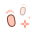
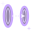
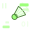

# 角色技能设计（微信 1.24.0 / 物理规则 24）

> 角色技能表由 `node tools/gen-skill-doc.js` 从 `js/roster.js` 的技能数据生成，改了技能数据后重新运行一次即可。每名角色 1 个被动（常驻）+ 3 个主动，赛前选 2 个主动携带，对局里两个技能键各对应一个。

## 总规则

- **场上始终只有一只真实计分的羽毛球。** 分身、假球、投影都只是干扰，不计分。田楚的镜像假球和真球一模一样（同样的拖尾、同样的落点圈），落地前会碎成水花，要靠读她的出手判断真假；路先森的脏数据球同样和真球长得一样，而且可以被击打（会白白用掉一次挥拍），落地后乱弹回另一边，被击打或弹回 5 次后消失。
- **特殊回球必须过网。** 反射板、长拍、旋拍、悠悠拍头、毫毛小猴、预约投影、月亮、星门、红丝带等装置替你回球时，以及地板开球弹起、回锅球再打、复制体击球、接力协议垫球时，按正常球路求解并越过球网；没过网照常算失误。
- **三位球友重制。** 朱朱带最佳挥拍合环提示，累计两次完美击球后球拍滴墨，下一拍附墨；被对方击打后立即爆墨致盲，可衔接回眸假球、短暂藏羽和压线贴网；孙大帅用不同花式积热手，强化第三段步法、双次篮板或宽压哨窗口；董总通过过载、雾线和熔断反压博弈。仅藏羽、险线、过载投递的准备跨分保留，其余新状态与本分资源随本分结束清除；墨涌累计进度、未使用的附墨和孙大帅已蓄满的热手跨分保留。
- **既有场上装置跨回合保留。** 反射板、风口、月亮、毫毛小猴、香蕉皮、积水、辅助线、冻结窗格、Ctrl+H、标志桶、预约投影、复制体、鱼跃留下的风，以及糖网、借网、星门、节拍这类持续状态，**一分打完不会消失**：死球期间倒计时暂停，下一分接着用完。一次性的控球状态（丝带牵引、绕月、回潮、冻结、肉包、重力球、托球）仍随这一分结束。
- **技能装置都看得见、有应对方式。** 每个装置都有醒目的形状、名字和倒计时；每个主动技能都有一句「应对提示」（朱老师的被动会在对手第一次使用时把这句话告诉你）。
- **再按一次＝第二段。** 设计里写“再按”的技能，统一为再按一次同一个技能键：红丝带甩出、松开月亮、长拍击球、拉回悠悠、释放肉包动能、收回锅球、借网弹射、提前解冻、开关重力、放下托住的球等。
- **技能独立瞄准。** 按住技能键、拖动选方向，松手释放，拖至 × 或拖远取消；点按采用默认方向。移动键独立控制走位。风道、反射板、自抛、红丝带、地板开球、肉包、冰窗、长拍、旋拍、悠悠、荡藤和接力协议支持拖动。月亮拖动选位置，再按沿切线甩出；鱼跃和踏风按住移动方向后点按使用。第二段可提前0.1秒按下。
- **新角色的持续技能跨分保留。** 高台、猎航、骨尾准备、滑步剩余段数、燕尾准备、退回、纸镖与滑翔准备、慢镜待机、复映和快进准备在分间与发球准备暂停计时，下一回合继续；剩余次数、台面高度、方向、旋力及录制轨迹保留。已开始的慢放、转体腾空、滑行与飞行中的折纸效果随当前球结束。
- **老南。** 切换短球、进攻球、深球积底片，镜头回球可回复能量与体力。慢镜准备两次来球，取景时减慢球并加强步法和够球；复映两拍可免费切近深，保留击球类别与左右球道；快进两拍在离拍后逐渐提速，保持原落点。三种搭配均可提前准备，再用普通击球触发。
- **四位新球友。** 骨尾、燕尾双旋、轨迹复映和快进一拍可提前准备，普通击球自动触发；滑步第二段保留6秒。脊骨高台提供持续高点站位，猎航支持追球、调高与多拍；转体可点按起飞。燕尾可连续用于两拍，再按切换急坠与漂长。马哥的当场退回、纸镖加急、周报滑翔均可提前9秒准备两拍，普通击球自动衔接；压力转接当拍借力、快速收拍。纸镖降低空气阻力，滑翔通过真实升力与阻力改变过网后的轨迹，支持同时发动。
- **回球辅助。** 辅助线在8秒内辅助两次手动回球，球路由玩家选择；反射板放置后0.45秒生效，朝固定落区出球；悠悠球拍把球带回拍前垫高，由玩家挥拍打出下一拍。
- **果哥的局内经济。** 初始500金币；手动回球+15、完美再+15，赢分+100、丢分−120。600高科技、900纳米、1200量子、1600火箭；金币跌破当前档位门槛超过60时降档，金币不高于0时负债。每分押注返还与金砖奖金合计最多350金币。火箭档每三次手动完美回球蓄满一次推进，10秒内下一记扣杀球速提升8%。
- **比赛提示。** 常规球路、速度、完美回球、装备收益与预判采用动作、球迹和HUD表达；漂浮文字保留技能触发、操作失败和体力告急，同一选手最多一条并节流重复提示。旋力用刻度，准备次数显示在技能图标下，移动路线用贴地标记。
- **受击状态。** 疾风击退、震地（短暂定身）、香蕉皮（滑倒不能挥拍）、红包（弯腰捡钱）都会在角色头顶标出，持续时间很短，可以读、可以躲。

## 能量

- 能量条 0~100，两个主动技能共用；能量 ≥ 技能消耗即可发动（启动消耗 10~35，部分技能另有持续消耗或金币费用）。
- 每拍 +3，完美击球再 +2，接杀 / 救低球再 +3；丢分 +13，得分 +4。
- 条件不满足时技能不会发动、也不扣能量，并提示原因（例如“球不在己方半场”“发球前才能用”）。
- 在线房间由服务器结算；技能装置、场地改动（短场 / 过滤规则 / 局部风道）、受控的球与状态都随快照同步给好友端。

## 凌风 · 空中机动

 **被动「差一点，也算一步」**：差一点接到球却失分时留下脚印，下一分踩到**+15 能量**；每分首次手动极限救球**+5 能量**。

| 主动技能 | 能量 | 效果 | 应对 |
|---|---|---|---|
|  鱼跃追球 | 25 | [按住移动方向]再按技能，朝那边**贴地飞扑救球**，卷起旋风；救起的球**过网急坠**，全场**顺风 4 秒**。*扑空会趴地*。 | 鱼跃救起的球会急坠：提前上网，并留意场上的风 |
|  空中踏风 | 20 | 空中**再跳一次**：[按住移动方向]就斜着横移，不按就直冲更高；之后这一拍带**疾风**：更快，**接球的人被击退**。 | 疾风球很重：站稳在中场，接完马上回位 |
|  风口急转 | 20 | [拖动]布置**风道 6 秒**，改变第一只经过的球的方向；自己经过时**移速和起步速度提升**。 | 避开风道里的球路，风道只改一球；他经过风道时回位更快 |

默认携带：鱼跃追球、空中踏风

## 沧澜 · 潮水

 **被动「滴水回澜」**：每次回球身后留一枚水滴（最多 3 枚），跑回去吸收**+12 体力**。

| 主动技能 | 能量 | 效果 | 应对 |
|---|---|---|---|
|  潮来 | 30 | 己方半场**积水 8 秒，最多托球两次**；每只来球第一次落水会弹起，第二次落水失分。 | 她的半场积了水：第一次落水的球会弹起来，别以为打死了；第二次落水才算分 |
|  同饮一潮 | 20 | 体力低于对手时**吸取差值的 40%，最多 25 体力**；否则**5 秒内扣杀少耗 20% 体力**。 | 她体力低时别拉长回合：速战速决 |
|  回潮（可再按） | 35 | 来球**沿原路倒流**回对面，[再按]就地松手下坠。积水弹起的球倒流**更快**，放下变**浪涌球**。*没过网就松手会落在自己场内*。 | 倒流的球随时会被放下：别站死；积水里卷起的浪涌球更快更重 |

默认携带：潮来、同饮一潮

## 小红 · 几何

 **被动「角度标尺」**：显示击球角度参考线；手动完美回球获得**校准标记**，使下次拖动布置的**反射板多拦截一次**。

| 主动技能 | 能量 | 效果 | 应对 |
|---|---|---|---|
|  几何反射板 | 25 | [拖动]放置反射板，**0.45 秒后生效，持续 10 秒**；拦截一次，朝**固定落区**出球，最多三板接力。 | 看板子标出的固定落区，提前移动；布置后有 0.45 秒准备时间 |
|  自抛自扣 | 25 | 把拍前来球**垫起再自己扣**：[拖动]选垫球**角度和力度**，可垫向反射板；点按垫到头顶。*第二拍失手白送一分*。 | 她把球垫起来要扣了：先退后防扣杀，板间接力看固定落区 |
|  辅助线 | 20 | 8 秒内辅助**两次手动回球**：击球时机更宽、质量更稳，并修正下网或出界的球路；**球路由你选择**。 | 她的两次手动回球更稳，多调动她，别送舒适的高球 |

默认携带：几何反射板、自抛自扣

## 冉冉 · 蝶结穿花与控网

 **被动「蝴蝶结」**：网前球过网后在网带留蝴蝶结（最多 2 个），**下一只擦网球会被托起**再落下。

| 主动技能 | 能量 | 效果 | 应对 |
|---|---|---|---|
|  穿花步（可再按） | 20 | 顺方向**轻跃抢位**，2.5 秒内下一次亲手回球质量至少 80%。2.1 秒内[再按]可**解开一个自己的蝴蝶结，折返一步**。 | 留意她脚下的丝带；逼她交出折返，再打远端空当 |
|  牵丝回旋（可再按） | 25 | [拖动]放出丝带**牵回来球**；再按压向网前，[向后／向上拖动]挑后场。也可亲手挥拍；**1 秒后自动出手**。 | 丝带只接己方球道的来球；她牵到球后，盯住出手方向 |
|  蝶结弹弓（可再按） | 25 | 解开一个自己的**蝴蝶结上弦**，下一次亲手回球**过网后急坠／挑长**。[再按]切换落区；6 秒内出手，过网高度须低于 3.35 米。 | 看球上的蝶结预告；打高远球避开她的网前连招 |

默认携带：穿花步、牵丝回旋

## 王瑞 · 花式回球

 **被动「越折腾，越来劲」**：地板球过网、回锅补拍或成功释放肉包各**+6 能量**，每分最多 18；肉包配地板可打出**蒸汽地板球**。

| 主动技能 | 能量 | 效果 | 应对 |
|---|---|---|---|
|  地板开球 | 25 | [拖动]选方向把球砸出，身后和头顶**临时立起两面墙**；地板、两面墙各弹一次，**每弹一次加速冒蒸汽**，砸地还会震定对手。 | 地板球会在他身后、头顶的墙上来回弹，每弹一次更快：看蒸汽，站中场等它出来 |
|  回锅再炒（可再按） | 25 | 给自己的球加回旋，对手碰到前[再按]**沿弧线收回己方**；*收回后得自己再打一拍*。 | 主动上前截击，逼他提早决定收不收 |
|  超大肉包球（可再按） | 25 | [拖动]投掷肉包包住球，**减慢球速、储存动能**；自己回球后[再按]**加速放出**，可配合地板或回锅。 | 肉包里的球会突然加速：别贴太近，等它出包再判断 |

默认携带：地板开球、回锅再炒

## 星星 · 星空与重力

 **被动「夜空记事」**：每完成两次**手动回球，额外 +6 能量**，每分最多 18；发球、自垫球、回锅补拍和装置回球不计。

| 主动技能 | 能量 | 效果 | 应对 |
|---|---|---|---|
|  月亮抓住了球（可再按） | 30 | [拖动]放月亮，来球被**抓住绕圈**；[再按]沿**切线方向甩出**，**转越多圈越快**；球还在己方半场可**再补一拍**，*甩出界、下网或落回己方算丢分*。 | 月亮里的球会沿切线甩出：看它转的方向，别贴着网等；她甩歪了就是你的分 |
|  星门对望 | 30 | [拖动]选择前后场出口；下一拍或**月亮出球穿越**，在出口**停 0.35 秒**后飞出。 | 星门出口发光时球还没出来：有 0.35 秒，朝出口方向移动 |
|  重力换班（可再按） | 10 | 使**重力球向上飘，月亮捕获范围增大**；启动耗 10 能量，每秒耗 6，最多 1.5 秒；[再按]关闭。 | 紫色的重力球随时会往上飘：别急着出拍，盯住她关掉的那一刻再迎 |

默认携带：月亮抓住了球、星门对望

## 丁丁 · 机械球拍与棘轮飞轮

 **被动「机械回收」**：机械装置击中球后**过载 3 秒，拦截范围扩大**；收招时[再按]快速回收，**返还 6 能量**。

| 主动技能 | 能量 | 效果 | 应对 |
|---|---|---|---|
|  伸缩长拍（可再按） | 25 | [拖动]任意角度快速伸拍，**拍头自动拦截重击**；[再按]扫击回收，过载时**范围更大**。 | 看拍头的路线，打到它够不着的地方 |
|  双头旋拍（可再按） | 25 | 双头球拍绕身旋转拦截；[再拖放]**朝指定方向扫击**，命中后[再按]快速回收；**过载时范围扩大**。 | 看二段扫回方向；高吊绕过，等他收招再打空当 |
|  棘轮悠悠（可再按） | 25 | 掷出**三瓣机械飞轮**截球，锁球后[再按]张弦弹射；**金色合齿窗口**出手更稳。不按则带回拍前，由你再打；手柄始终可挥拍。 | 飞轮锁球时亮金色窗口；他可以提前弹射，也能等飞轮带回后亲手打 |

默认携带：伸缩长拍、双头旋拍

## 猴子 · 驾云、荡藤与小猴

 **被动「连杀播报」**：连续得分时额外获得能量：**第 2 分 +3、第 3 分 +5、之后每分 +8**；两连胜以上被终结，对手 +10。

| 主动技能 | 能量 | 效果 | 应对 |
|---|---|---|---|
|  筋斗云 | 30 | 驾云**飞到来球最高点**悬停，这一拍**质量大增、可空中暴扣**；*云只停 1.4 秒*。 | 他会飞到高点等杀：打低平快球或放网 |
|  荡藤飞跃（可再按） | 25 | [拖动]选方向荡起，[再拖放]**定向飞出**；空中可微调，接**筋斗云或强化回击**。 | 他在藤上收不住：看他松手的方向，打另一边 |
|  毫毛小猴 | 30 | 召唤猴守场**7 秒、拦截一次**，准备后巡逻、丢一块香蕉皮；*高球可绕过*。 | 小猴来回巡逻：避开它的位置，看见香蕉皮就跳 |

默认携带：筋斗云、荡藤飞跃

## 路先森 · 程序指令

 **被动「错误日志」**：记录挥空原因；成功回击两类来球或接回日志中的来球，获得**编译标记**，可延长复制体或强化接力后的回球。

| 主动技能 | 能量 | 效果 | 应对 |
|---|---|---|---|
|  复制体 | 30 | 原地留下**复制体8秒**，同步跳跃、挥拍和技能；它打出的球落在己方半场**可弹起一次**。*复制体不会走动*。 | 复制体守着原地：把球打到它和本体都够不着的空当，别打它身边 |
|  接力协议 | 20 | 球到本体或复制体身边时，**垫给另一端**；[向上拖]高传、[平拖]快传，再按击球出手。没有复制体时**自垫一下**。 | 接力后要等他再挥一拍：盯住接力落点，准备接扣杀 |
|  脏数据 | 25 | 发出一只**对手看来和真球一样**的脏数据球，可以被击打；落地后**乱弹回另一边**，被击打或弹回5次后消失。复制体也会发一只。 | 脏数据球和真球长得一样：它落地会乱弹，真球只有一只 |

默认携带：复制体、接力协议

## 老陈 · 数据推演

 **被动「签到表」**：记录对手最近三次击球位置，同一前后场出现两次形成**习惯区**；预约该半场时投影更快，区内冰窗更大。

| 主动技能 | 能量 | 效果 | 应对 |
|---|---|---|---|
|  查找替换 | 25 | 在对手头顶挂上 Ctrl+H，**0.3 秒后把下一记进攻换成高球**；[向前拖]换成网前球；有效 7 秒。 | 你头上挂着 Ctrl+H：这时扣杀、平抽都会被替换成软球，先打吊球或高远 |
|  预约击球 | 25 | 预约半场 8 秒（[向前拖]网前，否则后场）：**对手的球落进去，投影替你接**。 | 投影只守半个场：往另一半打 |
|  冻结窗格（可再按） | 25 | [拖动]放置冰窗，**0.25 秒后可冻住第一只经过的球 1.2 秒**；[再按]使球在 0.16 秒后提前解冻。 | 冰窗只冻第一只球：被冻住的球会按原方向继续飞，盯住它解冻的瞬间 |

默认携带：查找替换、预约击球

## 果哥 · 投机与力量

 **被动「装备交易所」**：开局 500 金币，回球和得分赚钱，失分扣钱；**金币决定装备强度**，火箭档每三次完美回球蓄满一次推进。

| 主动技能 | 能量 | 效果 | 应对 |
|---|---|---|---|
|  押这一分 | 20 | 花 100 金币押自己赢：**发球前押中返还 300，回合中押中返还 200**；输了不返还，每分可押一次。 | 他押了这一分：稳住别失误，拖长回合让他着急 |
|  红包雨 | 25 | 花 **60 金币**往对手半场撒 **3 个红包**，持续 5 秒：对手**在地上踩到就弯腰捡钱，原地停 0.4 秒**；*起跳能躲开*。 | 地上的红包别踩：跳过去，或者绕开再接球 |
|  一掷千金 | 25 | 花 50 金币使下一拍变成**金砖球**，降低对手回球质量并震退；**这只球直接得分，额外奖励 200 金币**。 | 接金砖球会被震退，回球质量也会降低，提前站稳接球 |

默认携带：押这一分、红包雨

## 田楚 · 心理欺骗

 **被动「影子慢半拍」**：急停或转向时，身后留下**继续往前跑的残影**，扰乱对手判断。

| 主动技能 | 能量 | 效果 | 应对 |
|---|---|---|---|
|  镜花水月 | 30 | 球**一分为三**，三只一模一样。[向前拖]真球走近线，[向后拖]走远线，不按走原路。 | 三只里只有一只真：等到最后一刻再扑 |
|  这一拍，没打 | 20 | 来球时**虚挥一拍**，假球飞向对手，真球垫在身前；*你得再挥一拍打过去*。 | 第一只是假的：盯住他拍前那只 |
|  水中月（可再按） | 30 | 球过网后泛起水纹，[再按]**突然变轨**：[向前拖]收网前，[向后拖]送后场。原落点留虚影。 | 看到水纹先别动：等它拐弯 |

默认携带：镜花水月、这一拍，没打

## 朱老师 · 规则与示范

 **被动「三十年，看得懂」**：首次见到对手技能时显示应对提示；每分首次**手动接好技能球**后，**下一拍更稳定**。

| 主动技能 | 能量 | 效果 | 应对 |
|---|---|---|---|
|  一、二、一 | 25 | 10 秒内辅助三次回球：**前两拍由你选择球路，质量更稳**；**第三拍自动打向对手远端空当**。 | 前两拍由他选择球路，第三拍会自动打向远端空当，及时回到中场 |
|  标志桶 | 25 | 在对手身前摆标志桶 4.5 秒（[向后拖]摆身后）：**地上跑不过，只能跳**。 | 跳过标志桶，或提前绕到另一边 |
|  停一下，看站位 | 25 | 把近身来球**停在拍面上 1 秒**，可慢速走位；[按击球键]选择球路，以**完美质量**打出。 | 停球时回到中场，留意他的出手与落点 |

默认携带：一、二、一、标志桶

## 波波 · 骨翼腾空

 **被动「化石采样」**：每次手动回球记录一个击球高度，集齐低、中、高三层后**恢复 10 体力、获得 8 能量**。

| 主动技能 | 能量 | 效果 | 应对 |
|---|---|---|---|
|  脊骨高台（可再按） | 25 | 升起**持续 10 秒的骨骼高台**，站上后可连续高点扣杀；[再按]升降接低球；从台上展翼可猎航 6 秒。 | 高台固定在原地，打两侧空当或低球迫使他降台、离台。 |
|  始祖鸟猎航（可再按） | 20 | 点按进入**4.5 秒猎航**，移动快 55%、够球远 35%，自动调接球高度；**两次回球后收翼**，可接骨尾俯冲。 | 飞行有次数和时间限制，先调动两侧再放低球；观察剩余羽片，等他收翼后进攻。 |
|  骨尾甩击 | 30 | 提前蓄好骨尾，**8 秒内下一次普通击球自动接尾击**；拖动预选上挑或下压，**腾空时下压更强**。 | 看骨尾指向的角度，提前留意高弧与压低球路；调动他离开高点。 |

默认携带：脊骨高台、始祖鸟猎航

## 苗苗 · 旋转弧线

 **被动「顺势旋力」**：回球后回位1.15米**积一层旋力**，最多两层；强化下一拍真实弧线，滑步与转体也能积旋。

| 主动技能 | 能量 | 效果 | 应对 |
|---|---|---|---|
|  回旋滑步（可再按） | 20 | 两段**可选方向的快速滑步**，每段积一层旋力；可反向折返，接转体把惯性带入空中。 | 看脚下滑行方向，逼她交第二段后再调动；滑步没有自动接球。 |
|  燕尾双旋（可再按） | 25 | 准备**两拍旋转球**，再按切换：上拖漂长、下拖急坠；过网后弯曲增强，旋力越多变化越大。 | 看拍旁向上或向下的弧箭头；提前截击能压缩过网后的变线时间。 |
|  腾身转体 | 22 | **转体跃起并积一层旋力**，扩大空中接球范围；滑步后接跳继承惯性，可空中调整走位。 | 观察起跳惯性，打其身下低球或反方向；她仍需要够到真实来球。 |

默认携带：回旋滑步、燕尾双旋

## 马哥 · 折纸反击

 **被动「压力转接」**：手动接球**当拍借力**，来球越快反击越强；**缩短收拍**，每分前六次回球各回复 2 体力。

| 主动技能 | 能量 | 效果 | 应对 |
|---|---|---|---|
|  当场退回 | 25 | 提前备好**两拍借力反击**：接杀更稳、够球更远；杀抽借速打回，吊球卸成近网短球。 | 用慢吊减少借力，观察他的击球方式，防反打也防卸短。 |
|  纸镖加急 | 25 | 提前准备**两拍纸镖球**。羽裙收拢、阻力降低，打出更平、更有穿透力的真实球路。 | 纸镖减速较慢，提前回到中场，留意低平穿越球。 |
|  周报滑翔 | 25 | 提前准备**两拍折纸滑翔球**。过网展翼滑行，再收翼下坠；普通击球键继续决定长短。 | 看纸翼开合，可在展翼前截击；收翼后会落得更急。 |

默认携带：当场退回、纸镖加急

## 老南 · 回羽剪辑

 **被动「读羽留影」**：切换短球、进攻球或深球，**积一格底片**。用镜头技能打成界内回球，消耗一格并**回复 5 能量、4 体力**。

| 主动技能 | 能量 | 效果 | 应对 |
|---|---|---|---|
|  慢镜取景 | 30 | 9 秒内自动取景两只来球。来球靠近球网时**减速到 54%**，最多 1.45 秒；取景时更容易追球、够球和打稳。 | 落点照常，准备迎接他的变线；看到取景框后先回到中场。 |
|  轨迹复映（可再按） | 25 | 8 秒内**改剪两拍**，无需先录影。保留你选的击球方式，把落点剪近或推深。再按免费切换。 | 看他预备的是近剪还是深剪，避免太早押前场或后场。 |
|  快进一拍 | 25 | 8 秒内**加速两拍回球**。球先按正常速度出拍，再沿原球路逐渐加速；与慢镜或复映同时触发时更快。 | 看到快进箭头就先回位，按原落区接球，别等球提速才启动。 |

默认携带：慢镜取景、轨迹复映

## 朱朱 · 书法控球

 **被动「墨涌」**：累计**两次完美击球**后，**球拍滴墨**预告下拍附墨；附墨球**被对方击打时立即爆墨**。合环提示最佳挥拍时机。

| 主动技能 | 能量 | 效果 | 应对 |
|---|---|---|---|
|  飞白藏羽 | 25 | 下一拍先露出起飞，再**隐去 0.36 秒**；接近对手或降到低位自动显形，可与回眸假球配合。 | 记住最初的方向，不要盲目追影；在显形窗口或低点接球。 |
|  妩媚回眸 | 23 | 回眸侧身，**滑出一步并留香影**；4 秒内下一拍同时飞出一只**反向长短假球**。 | 香影和花瓣是假动作；先守中间，依据真正的触球声和复现判断。 |
|  朱砂险线（可再按） | 28 | 下一拍**压线或贴网**，再按切换。击球质量足够才校线；完美不加耗，普通出手多耗 8 体力。 | 看「压线/贴网」标记；逼她跑动勉强击球，险球就难以校准。 |

默认携带：飞白藏羽、妩媚回眸

## 孙大帅 · 篮球步法与流程连携

 **被动「三威胁热手」**：用**突破、空接、变节奏**中两种不同花式蓄满热手，选择强化下一招：**三段步、双篮板或长压哨**。

| 主动技能 | 能量 | 效果 | 应对 |
|---|---|---|---|
|  欧洲步换手（可再按） | 22 | 第一步**切入 1.35 米**，1.25 秒内再按可**换向跨出 1.65 米**；两段分别读移动方向。 | 不要追第一步；观察是否还有第二段，再把球送向他身后。 |
|  篮板空接 | 28 | 在己方架起一块**局部篮板**，托起一次下落来球；球留在己方，等待你**起跳二次进攻**。 | 把球打向篮板侧面或高远绕开，等他起跳后再准备反击。 |
|  压哨三秒 | 26 | 启动**三秒倒计时**；最后 0.8 秒的手动回球打出**加速险球**，超时付出 6 体力。 | 看倒计时，长高球拖过窗口，或逼他提前出拍。 |

默认携带：欧洲步换手、篮板空接

## 董总 · 安全防御与资源调度

 **被动「负载回收」**：亲手接住**高点或高速来球**，或让对手接到过载球，积**一格缓存**，用于雾幕下沉或反压补给。

| 主动技能 | 能量 | 效果 | 应对 |
|---|---|---|---|
|  过载投递 | 28 | 下一拍携带**过载**：对方接球多耗 12 体力；其**下两拍收招变慢、质量下降**。 | 短吊卸力清掉两拍负载，或用装置接球；不要疲劳时连续跳杀。 |
|  天空迷雾（可再按） | 27 | 对面半场升起**2.6 米以上迷雾**；再按可降到 1.95 米，但缩短两秒，缓存可抵消代价。 | 盯住入雾方向和雾线，提前站位；平低回球和贴网短球不受迷雾影响。 |
|  熔断反压 | 28 | 立即**结束收招、清除过载与墨盲**；5 秒内下次手动接球稳住反击，**吞过载、缓存增压**。 | 用慢吊减少反压收益，拉开左右与长短；观察护罩消失后再打重球。 |

默认携带：过载投递、天空迷雾

## 实现位置

| 部分 | 文件 |
|---|---|
| 技能数据（名称、消耗、描述、应对提示、音效） | `js/roster.js` |
| 技能引擎（施放条件、装置、受控球、规则改动、被动、跨回合保留） | `js/match.js`（`Object.assign(Match.prototype, …)` 一段，`PERSIST` / `PERSIST_BUFF`） |
| 物理环境（球网高度、局部重力、场上的风） | `js/core.js` `stepShuttle` / `netContact` 与 `Match.physEnv()` |
| 装置与特效绘制 | `js/skillfx.js`（地面 / 球网 / 空中 / 最上层 / 屏幕 / 特殊姿态） |
| AI 施放与应对 | `js/ai.js` `thinkSkill` / `thinkPre` / `decideShot` |
| 联机同步 | `YY.skPack` / `YY.skUnpack`（`js/match.js`），快照字段 `k` |
| 回归测试 | `tools/skill-kit.test.js`、`tools/skill-rework.test.js`、`tools/story-skills.test.js` |
