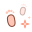
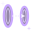
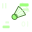
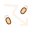

# 角色技能说明（Web 1.32 / 物理规则 34）

> 由 `node tools/gen-skill-doc.js` 生成。简短摘要、完整效果和分模式操作共用 `js/roster.js` 的玩家文案，研习页读取同一数据。每名角色1个被动、3个主动，赛前选2个主动携带。

## 先读这些操作规则

- **手动回球**：自己按高远、吊球或扣杀键并实际击中球。装置自动代接、发球、自垫是否触发奖励，按各技能说明执行。
- **准备下一拍**：先按技能键开启效果，再用普通击球键接球；技能不会替你挥拍。**收拍**是击球后恢复到可以再次挥拍的过程。完美回球通常指击球质量至少85%。
- **2D方向**：说明写“拖动技能键”时，按住该键拖到方向再松手；向前指朝球网，向后指远离球网。写“按住移动方向”时，用移动键选方向并点技能，不拖技能键。点按的默认行为按各技能说明执行。
- **3D方向**：推住摇杆选方向，再点技能键；不拖动技能键。向网推为前，远离网为后，左右为横向球道。部分技能的近深选择不同，逐项看3D操作，不能套用2D拖动方向。
- **深浅选择**：选择出球落点或对方目标区时，统一前推/前拖为深，后推/后拖为浅；左右选球道。移动、伸拍、投掷与己方装置位置仍按实际方向操作。
- **再按**：再次按同一个技能键，可能是切换、第二段、回收或提前结束；并非所有技能都能再按。第二段需满足各自条件，缺少条件时可能失败，或按新一次施放扣能量。
- **时间和次数**：已准备的持续效果及场上装置通常保留未用完的时间和次数，分间和发球准备暂停；已开始的移动、持球和本球飞行随当前分结束。每项详情的“分间保留”按其实现标示。押注在本分结算。
- **能量与费用**：两个主动技能共用0至100能量；金币、额外体力和持续耗能单独说明。额外体力基准值可能受角色、装备及疲劳倍率影响。技能关闭的比赛不触发技能效果。
- **真球与假球**：只有真球计分。镜像、回眸和脏数据是不同的假球机制，脏数据可骗掉一次挥拍。星门传送和网底滚动等有明确规则例外；普通球路仍按球网、边线和实际触球判定。
- **演示**：三阶段图用于解释机制，不按真实距离、速度与范围绘制；具体操作与数值以下方完整说明为准。

## 凌风 · 空中机动

 **被动「差一点，也算一步」**：险些接到的来球落地后留下脚印，下分捡起回**15能量**；每分首次手动极限救球成功，额外回**5能量**。

| 主动技能 | 能量 | 效果 |
|---|---|---|
|  鱼跃追球 | 25 | 朝移动方向**扑救低球**，拍头碰到球会自动回击并使球过网急坠；同时吹起4秒顺风，扑空会趴地。 |
|  空中踏风 | 20 | 空中**再跳一次**；1.8秒内下一拍附带击退，扣杀或平抽还会加速。每次腾空只能踏风一次。 |
|  风口急转 | 20 | 放置**6秒风道**，使第一只经过的球改变方向；自己经过风道时，移速和起步速度提高。 |

默认携带：鱼跃追球、空中踏风

### 差一点，也算一步 · 角色被动

对手的球在你身边落地得分时，会留下一个脚印；从下一分开始，落地走近脚印可恢复15能量。每分第一次手动完成极限救球或低球救险，另外恢复5能量。

- 2D 操作：不用按技能键。看到脚印后，在下一分走过去拾取；救球奖励在手动击中时自动结算。
- 3D 操作：不用按技能键。看到脚印后，在下一分走过去拾取；救球奖励在手动击中时自动结算。
- 释放条件：无需按键；按上述条件自动触发。
- 性能与代价：不是每次挥空都留脚印：须为对手落地得分，落点前后距离你小于2.4米。脚印最多一个，只保留到下一分结束，拾取一次即消失。
- 演示分解：极限救球 → 失败留下脚印 → 下一分拾取补能
- 实战思路：不用按技能键。看到脚印后，在下一分走过去拾取；救球奖励在手动击中时自动结算。

### 鱼跃追球 · 救险位移

落地时向所选方向飞扑，自动回击拍头附近、高度不超过1.1米的来球。救起的球过网后急坠。发动就会产生4秒顺风；没有接到球会趴地，暂时不能移动或挥拍。

- 2D 操作：按住移动方向，再点技能键；不按方向时自动朝来球落区扑。扑救本身会接低球，无需再按击球键。
- 3D 操作：按住移动方向，再点技能键；不按方向时自动朝来球落区扑。扑救本身会接低球，无需再按击球键。
- 释放条件：回合中，落地后使用。
- 性能与代价：只能在地面发动。只接真实拍头范围内的低球；扑救不保证成功，也不能救到身后的远球。
- 演示分解：选方向追低球 → 拍头自动救起 → 救起后回位
- 实战思路：提前朝低球方向扑，让拍头碰到球；飞扑会自动接球，扑空后有趴地空当。

### 空中踏风 · 空中机动

在空中再次向上跳，按住移动方向可向前或向后跃进。1.8秒内下一次回球带击退效果；扣杀或平抽的初速度提高22%，高远与吊球不获得这项加速。

- 2D 操作：先按跳跃键，腾空后按住移动方向并点技能键；随后仍需自己按击球键。
- 3D 操作：先按跳跃键，腾空后按住移动方向并点技能键；随后仍需自己按击球键。
- 释放条件：回合中，已在空中；每次起跳只能踏风一次。
- 性能与代价：每次腾空只能发动一次，落地后才可再用。1.8秒内未击球，强化会到期。
- 演示分解：先起跳 → 空踏再跃 → 高点击球
- 实战思路：把第二次起跳留给高球或快球；踏风只强化下一拍，仍要亲自挥拍。

### 风口急转 · 球路干预

布置一处局部风道，持续6秒。首个穿过作用范围的球会受推力改变球路；自己经过风道时，移速提高10%、起步加速度提高25%。

- 2D 操作：按住技能键拖动选择风道位置和推力方向，松手放置；点按使用默认位置。
- 3D 操作：推住摇杆选择前后与左右位置，再点技能键放风道；不推杆时自动参考来球路线。
- 释放条件：回合中使用，须有足够能量；重复施放限制见下方。
- 性能与代价：只改变一球，之后仍可借风加速跑位。原风道未消失前不能重复放置。
- 演示分解：布置风道 → 首球转向 → 借风回位
- 实战思路：把风道放在对手常打的线路上，同时借风加速回位；风道只改第一只球。

## 沧澜 · 潮水

 **被动「滴水回澜」**：手动回球后在身后留下水滴，最多**3枚**；落地走近一枚，恢复**12体力**。

| 主动技能 | 能量 | 效果 |
|---|---|---|
|  潮来 | 30 | 己方半场出现**8秒积水**，最多把对手来球托起**2次**；同一段来球第二次落水仍会失分。 |
|  同饮一潮 | 20 | 体力落后时**吸取差值的40%**，最多25点，对手等量减少；否则5秒内扣杀少耗20%体力。 |
|  回潮（可再按） | 35 | 让己方来球**沿原路倒退**，再按放开后低速落下；积水托起的球可更快倒退，并使对手回球更差。 |

默认携带：潮来、同饮一潮

### 滴水回澜 · 角色被动

手动回球后，在自己身后约0.6米处留下水滴。最多保留3枚，新水滴会替换最早的一枚；站在地面走近水滴，拾取后恢复12体力。

- 2D 操作：不用按技能键。回球后退一步捡水滴，再移动到下一球的接球位置。
- 3D 操作：不用按技能键。回球后退一步捡水滴，再移动到下一球的接球位置。
- 释放条件：无需按键；按上述条件自动触发。
- 性能与代价：装置代接不产生水滴。每枚只能拾取一次；体力不会超过上限。
- 演示分解：完成回球 → 水滴留场 → 拾取回复体力
- 实战思路：不用按技能键。回球后退一步捡水滴，再移动到下一球的接球位置。

### 潮来 · 守场续球

在己方半场铺8秒积水。对手的来球第一次落在界内积水中会弹起，让你还有一次接球机会；总共可托球2次。同一段来球已经弹过，再次落地就正常判分。

- 2D 操作：来不及接落地球时点技能键铺水。球弹起来后，移动到球旁并手动回击。
- 3D 操作：来不及接落地球时点技能键铺水。球弹起来后，移动到球旁并手动回击。
- 释放条件：回合中使用，须有足够能量；重复施放限制见下方。
- 性能与代价：不托自己的球、已撞网的球或界外球。两次托球机会用完后，水面不再救球。
- 演示分解：积水展开 → 首次落水弹起 → 补拍续球
- 实战思路：被动时用积水弹起争取补拍；同一只球第二次落水就判分，别当救命符。

### 同饮一潮 · 资源运营

若你的体力低于对手，从对手处吸取双方差值的40%，最多25点：你增加多少，对手就减少多少。若你体力不低于对手，改为5秒内扣杀体力消耗降低20%。

- 2D 操作：比较双方体力条后点技能键；生效类型按按下时的体力决定。
- 3D 操作：比较双方体力条后点技能键；生效类型按按下时的体力决定。
- 释放条件：回合中使用，须有足够能量；重复施放限制见下方。
- 性能与代价：吸取和省力只生效一种。省力不会直接补体力，也不减少技能能量费用。
- 演示分解：比较体力 → 吸取或省耗 → 保留进攻余力
- 实战思路：体力落后时吸一口，体力领先时用它省扣杀消耗；满体力时别浪费。

### 回潮 · 节奏控制

把已进入己方半场的来球沿记录的飞行轨迹倒放。再按技能键可在当前位置放开，球会轻轻上抬后低速下落；倒放到起点也会自动放开。若球刚被己方积水托起且积水仍在，倒放更快，放开的球会压低对手回球质量。

- 2D 操作：等来球过网并进入己方后点技能键；看球退到合适位置，再按同一技能键放开。
- 3D 操作：等来球过网并进入己方后点技能键；看球退到合适位置，再按同一技能键放开。
- 释放条件：来球已过网进入己方，且已留下足够飞行轨迹。
- 性能与代价：来球须有足够轨迹且未被其他装置控制。放开算你的触球，未过网、落在己方或出界仍会失分。
- 演示分解：等来球过网 → 沿原轨迹倒退 → 再按低速放开
- 实战思路：看倒退后的球处在哪一侧再放开；在己方放开仍要避免球直接落地。

## 小红 · 几何

 **被动「角度标尺」**：显示击球角度线；手动完美回球获得**校准标记**，下次手动选位置的反射板多拦1球，每分最多获2次。

| 主动技能 | 能量 | 效果 |
|---|---|---|
|  几何反射板 | 25 | 放置**10秒反射板**，0.45秒后可自动回击1球；最多同时3块，手动放板可用校准多拦1球。 |
|  自抛自扣 | 25 | 把拍前来球**垫起来**；点按垫向头顶，拖动选择垫球方向和力度，再自己挥拍进攻。 |
|  辅助线 | 20 | **8秒内辅助2次手动回球**：击球时机窗扩大20%，质量至少82%，并尝试修正下网或出界球路。 |

默认携带：几何反射板、自抛自扣

### 角度标尺 · 角色被动

显示击球角度参考线。手动回球质量达到85%可获得一个校准标记，每分最多获得2次。下次手动指定位置放反射板时消耗标记，使该板从拦1球变为拦2球。

- 2D 操作：不用按被动键。先打出完美回球，再拖动反射板技能选位置放置；直接点按自动放板不会消耗标记。
- 3D 操作：不用按被动键。先打出完美回球，再推住摇杆点反射板，手动选位置并消耗校准；不推杆的自动放板不消耗标记。
- 释放条件：无需按键；按上述条件自动触发。
- 性能与代价：同时最多存一个标记；装置回球不获得标记。标记须配合几何反射板使用。
- 演示分解：观察角度线 → 手动完美回球 → 反射板多拦一次
- 实战思路：不用按被动键。先打出完美回球，再拖动反射板技能选位置放置；直接点按自动放板不会消耗标记。

### 几何反射板 · 场上装置

反射板放置0.45秒后开始拦球，持续10秒，通常拦1球。出球目标在放置时确定，不追踪对手；多块板可接力。最多同时3块，放第4块会替换最早的一块。

3D效果差异：反射板放置0.45秒后开始拦球，持续10秒，通常拦1球。球道与出口落点在放置时确定，不会追球。最多同时3块，可接力；有校准时推住摇杆手动放板，可多拦1球。

- 2D 操作：按住技能键拖动选位置，松手放置；点按会尝试布在来球路线上。有校准标记时，拖动放置会让这块板多拦1球。
- 3D 操作：推住摇杆选择前后与左右位置，再点技能键放板；高度自动参考来球。不推杆时自动选位，不消耗校准标记。
- 释放条件：回合中使用，须有足够能量；重复施放限制见下方。
- 性能与代价：来球必须碰到已生效的板；板不会自动追球。校准仅用于手动选位置放的板。
- 演示分解：放置反射板 → 准备后拦球 → 射向固定落区
- 实战思路：提前把板放在对手常打的线路上；板有 0.45 秒延迟，别等球到才放。

### 自抛自扣 · 接力起手

把拍前的真实来球垫起，允许自己再打一次。点按采用向上的默认垫球；拖动可改变垫球角度和力度，也可把球送向自己的反射板。

3D效果差异：把己方拍前的真实来球垫起，允许自己再打一次。不推杆点按会默认垫高，前后推杆可改变前后垫球方向。垫球后仍需手动回击，不能把垫球当成已完成进攻。

- 2D 操作：等球靠近拍前时点按；或按住技能键拖动后松手。垫起后要再按高远、吊球或扣杀完成回击。
- 3D 操作：等球靠近拍前时点技能键默认垫高；前后推杆后点按可改变垫球方向。垫起后仍要自己按击球键补拍。
- 释放条件：来球进入己方拍前范围，且未被装置控制。
- 性能与代价：球须在己方拍前且未被控制。自垫不等于已经把球回给对手，漏掉下一拍仍会失分。
- 演示分解：拍前截球 → 自抛垫高 → 手动再进攻
- 实战思路：把低位球垫成高点再进攻；垫起不等于得分，记得接下一拍。

### 辅助线 · 回球强化

准备8秒内的2次回球辅助。击球时机窗口扩大20%，回球质量至少82%；若预计下网或出界，会尝试改为安全球路。正常球路仍按你选择的击球方式打出。

- 2D 操作：先点技能键准备，再移动并手动击球。每次辅助成功消耗一次，挥空不会消耗次数。
- 3D 操作：先点技能键准备，再移动并手动击球。每次辅助成功消耗一次，挥空不会消耗次数。
- 释放条件：回合中使用，须有足够能量；重复施放限制见下方。
- 性能与代价：不会自动挥拍，也不会增加球拍够不到的距离。修正仍受球网与边线判定。
- 演示分解：开启校准 → 两次稳定回球 → 站稳再落拍
- 实战思路：接快球或疲劳时开启，用两次稳定回球度过难关；它不会替你挥拍。

## 冉冉 · 蝶结穿花与控网

 **被动「蝶结巧手」**：网前2.8米内亲手接球**质量至少86%、收拍快30%**，抢拍范围扩大12%；短球过网织结，最多3个，每分前4次回3能量、5体力。

| 主动技能 | 能量 | 效果 |
|---|---|---|
|  穿花步（可再按） | 20 | 向移动方向**轻跃1.9米**；3秒内可免费换向再跃2.1米。下一拍质量至少84%，网前提高到92%。 |
|  牵丝回旋（可再按） | 22 | 丝带截球拉回拍前；网前抓球范围扩大，持球**1.25秒**。再按选长短，亲手回击质量至少96%。 |
|  蝶域织网（可再按） | 25 | 展开**8秒蝶域：2拍变线、1次截流**；有结自动消耗1个，升级为3拍、2次截流。前推深、后推浅。 |

默认携带：穿花步、牵丝回旋

### 蝶结巧手 · 角色被动

本人和触球点都在己方网前2.8米内、球高不超过3.35米时，抢拍范围扩大12%、击球时机窗口扩大20%，亲手接对方过网球质量至少86%，剩余收拍缩短30%。吊、搓、挡等短球成功过网生成一个蝴蝶结，己方最多3个；每分前4次织结恢复3能量、5体力。

- 2D 操作：上网接球，再用吊球键搓放或挡网，成功过网后自动织结。已有的结可保护己方下一次轻擦网，也能强化蝶域。
- 3D 操作：上网接球，再用吊球键搓放或挡网，成功过网后自动织结。已有的结可保护己方下一次轻擦网，也能强化蝶域。
- 释放条件：无需按键；按上述条件自动触发。
- 性能与代价：蝴蝶结只救己方非发球的轻擦网，不救对手，也不救撞在低处的球。发球、自抛和装置代打不织结；后场不享受网前强化。
- 演示分解：抢网稳拍 → 短球过网织结 → 回能并护己方擦网
- 实战思路：上网接球，再用吊球键搓放或挡网，成功过网后自动织结。已有的结可保护己方下一次轻擦网，也能强化蝶域。

### 穿花步 · 步法变化

第一段轻跃1.9米，发动后3秒内可在落地时免费使用一次2.1米折返，不消耗蝴蝶结。每段后3秒内下一次亲手接对方过网球质量至少84%，网前触球提高到92%。

- 2D 操作：按住移动方向点技能键。第一段落地后改变方向，再按同一技能键折返；3D可以向左右或斜向抢位。
- 3D 操作：按住移动方向点技能键。第一段落地后改变方向，再按同一技能键折返；3D可以向左右或斜向抢位。
- 释放条件：回合中落地使用；第一段后3秒内可以免费换向第二段，不消耗蝴蝶结。
- 性能与代价：需要落地且未被固定。免费第二段只有一次；两段都要自己挥拍，不能越网，也不会自动接球。
- 演示分解：穿花抢位 → 稳住下一拍 → 免费折返
- 实战思路：先抢网稳拍，再用免费第二段追短球或撤回；三秒内决定方向。

### 牵丝回旋 · 持球变化

丝带实际碰到来球后拉回拍前。本人和来球都在己方网前2.8米内时，抓球半径扩大至0.58米，持球1.25秒，并给2秒内的网前亲手回击至少96%质量；后场维持普通抓球与1秒持球。网前再按可放到距网约0.85米或挑向底线。

3D效果差异：丝带沿选定球道伸出，抓住范围内的球并拉向拍前。抓到后再按技能键出球：前推摇杆挑深，点按或后推打浅，左右推杆选择球道。网前抓球持有1.25秒，2秒内亲手回击质量至少96%；后场持球1秒，超时自动出球。

- 2D 操作：首次点按追向来球，拖动可手动瞄准。抓到后向前推或拖挑深，向后压浅；点按默认短，也可以用普通击球键亲手衔接。
- 3D 操作：推住摇杆后点技能键，向所选球道伸丝带；不推杆则自动朝来球。抓到后，前推再按挑深，点按或后推再按打浅；左右推杆选择出球球道，也可手动挥拍。
- 释放条件：回合中使用，须有足够能量；重复施放限制见下方。
- 性能与代价：只能抓已过网的对方球，必须实际碰到；3D不能隔球道抓球。持球到时自动出球，技能代打不生成蝴蝶结。
- 演示分解：牵住来球 → 观察站位 → 二段选长短
- 实战思路：牵住球后先看对手站位，再决定放短还是挑长；网前持球1.25秒，亲手回击更精准。

### 蝶域织网 · 长短变线

在当前球道展开8秒蝶域，0.3秒后生效。域内移动加快16%、起步加快25%。本人守在网前2.8米内时，截住高度1.55至2.65米、经过己方距网0.55米处的对方来球，使其减速抬起，需自己上网回击。期间2次网前亲手回球可过网压到约0.82米或挑至底线；有结消耗1个升级为3拍、2截，球道半宽从1.15米扩至1.45米。

- 2D 操作：无蝴蝶结也能使用。先上网选好球道，点按展开短球模式；向前拖或推选深，向后选浅，再点按切换。随后用普通击球键手动接球，3D在触球时选左右落点。
- 3D 操作：在当前球道展开8秒蝶域，前推摇杆再点选择深场球、后推选浅场；准备后点按切换，带方向再按重选。随后手动接球，左右球道读取触球时的摇杆。
- 释放条件：无需蝴蝶结；有结自动消耗一个强化。守在网前与覆盖球道内才会截流。
- 性能与代价：范围固定，不跟随人物移动；离开网前或离开覆盖球道不会截流。高远球、发球和范围外球路可穿过；后场击球、高远或挑球不消耗变线次数，只有成功的低过网变线才扣次数。
- 演示分解：展开固定蝶域 → 截流后亲手回击 → 两拍放短或挑深
- 实战思路：守在蝶域内截住低球，亲手接球打长短；有蝴蝶结可增至三拍两截，高球和边线可绕开。

## 磐岩 · 锅台火候与连携

 **被动「越折腾，越来劲」**：完成锅台招式回**6能量、8体力**，每分最多4次；8秒内成功接上另一招，下一拍获得**旺火强化**。

| 主动技能 | 能量 | 效果 |
|---|---|---|
|  地板开球（可再按） | 22 | 准备**8秒内下一拍砸地反弹**，拍前有球可直接砸；反弹后再按选择短球或长球，地面震波可绊住对手。 |
|  回锅再炒（可再按） | 20 | 准备**8秒内下一拍回锅**，或标记已打出的球；再按把球收回，随后自己挥拍，补拍更稳、收拍更快。 |
|  超大肉包球（可再按） | 22 | 用肉包**包球减速并储能**；点按可准备下一拍，近处有来球会投包。自己回球后再按，加速打短或打长。 |

默认携带：地板开球、回锅再炒

### 越折腾，越来劲 · 角色被动

地板球过网、回锅后完成补拍或成功释放肉包能量，会恢复6能量、8体力，每分最多4次。8秒内成功接上不同锅台招式，获得6秒旺火：下一次手动回球更稳、收拍更快，进攻球还会强化。

- 2D 操作：不用按被动键。先完成一招，再在8秒内完成另一招；只按准备键而没有完成招式，不会获得奖励。
- 3D 操作：不用按被动键。先完成一招，再在8秒内完成另一招；只按准备键而没有完成招式，不会获得奖励。
- 释放条件：无需按键；按上述条件自动触发。
- 性能与代价：旺火只强化下一拍，不能无限叠加。回球仍需手动触球，不能跳过接球。
- 演示分解：完成一招 · 回能回体 → 8秒内换另一招 → 旺火 · 强化下一拍
- 实战思路：不用按被动键。先完成一招，再在8秒内完成另一招；只按准备键而没有完成招式，不会获得奖励。

### 地板开球 · 弹射球路

近处有来球时直接砸地；否则准备8秒，下一次手动击球改成砸地反弹。球首次落在己方地板可弹起，并放出地面震波。反弹后再按可主动把球送向短区或后场；包着肉包时弹射更强。

- 2D 操作：点按准备或直接砸球。反弹后再按同一技能键出球；向前拖选深，向后拖选浅，也可在反弹前预选。
- 3D 操作：点技能键准备或砸球。反弹后推住摇杆再按出球：向网推选深，后推选浅，左右推选球道；也可提前预选。
- 释放条件：回合中可提前准备；直接砸球要求己方拍前真实来球。
- 性能与代价：地板只豁免一次己方落地；之后仍须正常过网。地面震波可被起跳躲开，第二段不另扣能量。
- 演示分解：备锅 / 拍前砸地 → 反弹蓄力 → 再按出锅选长短
- 实战思路：肉包入锅变成爆馅弹射；出锅后挂回锅，可收回再打一记旺火补拍。

### 回锅再炒 · 节奏控制

给自己已打出的球加回锅标记，或提前准备8秒等待下一次手动回球。再按把球收回拍前，随后可手动补拍。回收后4秒内补拍质量至少92%；回收地板球会点燃旺火，肉包的蓄力也会保留。

- 2D 操作：点按准备或标记己方出球；在对手够到球前再按收回。球回到拍前后，再按普通击球键打出去。
- 3D 操作：点按准备或标记己方出球；在对手够到球前再按收回。球回到拍前后，再按普通击球键打出去。
- 释放条件：回合中可提前准备；回收须仍为己方出球且未进入对手截击范围。
- 性能与代价：对手已触球、球被控制或已进入对手1.6米拍前范围时不能收回。一次标记只回收一次。
- 演示分解：下一拍挂回旋 → 收回保留馅料 → 旺火补拍 / 再包球
- 实战思路：先用地板或肉包迫对手移动，再收回改变下一拍；肉包蓄力能带回并重新包球。

### 超大肉包球 · 持球变化

没有近处来球时点按，准备8秒内下一次手动回球；近处有来球或手动瞄准时，会掷出肉包，碰球后减速储能。包球持续6秒。必须先亲手回球，再按技能释放储存能量，选择网前或后场落点。

- 2D 操作：点按准备或自动投包；拖动技能键可瞄准投包。自己回球后，向前拖再释放打深，向后拖打浅。
- 3D 操作：不推杆时点按准备；近处有来球或推杆时点按会自动瞄准投包。自己回球后，前推再按打深、后推打浅、左右推选球道。
- 释放条件：回合中使用，须有足够能量；重复施放限制见下方。
- 性能与代价：包住来球不会自动替你回击。投包可能落空；球已越过目标短区时不能倒飞回去偷分。
- 演示分解：上拍 / 投包减速 → 回球保留蓄力 → 爆馅选长短
- 实战思路：慢球诱导走位后爆馅；可把蓄力送进地板弹射，或回锅保馅后再次发动。

## 星星 · 星空与重力

 **被动「夜空记事」**：每完成**2次手动回球**额外恢复**6能量**，每分最多18点；发球、装置回球和自垫不计入。

| 主动技能 | 能量 | 效果 |
|---|---|---|
|  月亮抓住了球（可再按） | 30 | 放置**6秒月亮**抓住来球并使其绕圈；再按沿切线甩出，转久更快。在己方甩出后可手动补拍。 |
|  星门对望 | 30 | 准备**8秒内下一次回球**穿过星门；可选前场或后场出口，球到出口停**0.35秒**再飞出。 |
|  重力换班（可再按） | 10 | 让带有自己重力标记的球**上飘**，并扩大月亮抓球范围；最多1.5秒，每秒另耗6能量，再按关闭。 |

默认携带：月亮抓住了球、星门对望

### 夜空记事 · 角色被动

手动回球每累计2次，额外恢复6能量，每分最多恢复18能量。星点显示当前累计进度；仍须自己完成触球。

- 2D 操作：不用按技能键。正常接回对手的球即可积累，星点凑成一对时自动回复能量。
- 3D 操作：不用按技能键。正常接回对手的球即可积累，星点凑成一对时自动回复能量。
- 释放条件：无需按键；按上述条件自动触发。
- 性能与代价：发球、装置直接回球、自垫动作和回锅补拍不计入这项奖励。
- 演示分解：手动回球 → 累计两次 → 额外回复能量
- 实战思路：不用按技能键。正常接回对手的球即可积累，星点凑成一对时自动回复能量。

### 月亮抓住了球 · 旋转拦截

放置月亮，最多等待6秒捕获范围内的球。抓到后最多绕行3.4秒，再按技能键沿当前切线甩出；转得越久速度越高，超时会自动放开。若甩出时仍在己方半场，可再手动补拍。

- 2D 操作：拖动技能键选择月亮位置后松手；点按用默认位置。抓到球后观察转圈方向，再点同一技能键甩出。
- 3D 操作：推住摇杆选择月亮的前后与左右位置，再点技能键；高度自动参考来球。抓球后看转圈方向，再点同一技能键沿切线甩出。
- 释放条件：回合中使用，须有足够能量；重复施放限制见下方。
- 性能与代价：不是瞄准哪里就射向哪里：出球取决于按下瞬间的切线。撞网、出界或落在己方仍会失分。
- 演示分解：月亮捕球 → 绕月旋转 → 二段切线出球
- 实战思路：把月亮放在对手常打的线路上，锁球后看准切线再甩；甩歪了要自己补拍。

### 星门对望 · 空间转移

准备8秒内下一次手动回球，或月亮甩出的球。球进入星门后会从所选前场或后场出口出现，停留0.35秒后飞出；点按默认根据对手前后位置选择出口。

- 2D 操作：向前拖技能键选深场出口，向后拖选浅场；点按自动选择。准备好后再手动回球，或用月亮甩球。
- 3D 操作：前推摇杆后点技能键选深场出口，后推选浅场，不推则自动选择。随后手动回球或用月亮甩出；出口左右位置随出球球道。
- 释放条件：回合中使用，须有足够能量；重复施放限制见下方。
- 性能与代价：普通装置代接不会触发，月亮例外。出口有停顿，球出门后仍按真实飞行和落点判分。
- 演示分解：选定出口 → 球穿越星门 → 出口延迟后飞出
- 实战思路：把出口和当前球路错开，用 0.35 秒停顿改变对手启动；仍要合法过网。

### 重力换班 · 飞行控制

携带此技能后，自己打过的球会留下重力标记。开启时，带自己标记的球向上飘，并扩大月亮抓球范围。开启耗10能量，再每秒耗6能量，最多1.5秒；再次按键关闭。

- 2D 操作：先回球留下标记，再点技能键开启；合适时再按关闭，让球恢复下落。也可提前开启等待自己的标记球。
- 3D 操作：先回球留下标记，再点技能键开启；合适时再按关闭，让球恢复下落。也可提前开启等待自己的标记球。
- 释放条件：回合中使用，须有足够能量；重复施放限制见下方。
- 性能与代价：不是所有来球都立即上飘。能量耗尽也会关闭；关闭后需等1秒才能再次开启。
- 演示分解：自己回球留标记 → 开启使标记球上飘 → 关闭恢复下落
- 实战思路：先让球带上自己的重力标记再开关，利用短暂上飘改变节奏；不要长按浪费能量。

## 丁丁 · 机械球拍与棘轮飞轮

 **被动「机械回收」**：机械装置接球后获得**3秒过载**，后续装置范围更大；收招窗口内再按回收，恢复**6能量**。

| 主动技能 | 能量 | 效果 |
|---|---|---|
|  伸缩长拍（可再按） | 25 | 朝所选方向伸出**长拍**自动拦球；再按就地扫击并收回，收招时还可再按快速回收。 |
|  双头旋拍（可再按） | 25 | 双头拍**绕身扫一圈**自动拦1球；未命中时再按可追加扫击，命中后再按快速回收。 |
|  棘轮悠悠（可再按） | 25 | 投出**飞轮截球**；抓球后再按弹射，金色窗口内更准更快；不按则带回拍前，留给自己再打一拍。 |

默认携带：伸缩长拍、双头旋拍

### 机械回收 · 角色被动

机械装置成功接球后获得3秒过载，提高起步速度，期间新发动的机械招式作用范围更大。装置进入收招后的回收窗口内，再按技能键可快速收回并恢复6能量。

- 2D 操作：不用按被动键。看机械技能变成回收提示后，再按刚才的技能；也可按与装置伸出方向相反的移动方向回收。
- 3D 操作：不用按被动键。看机械技能变成回收提示后，再按刚才的技能；也可按与装置伸出方向相反的移动方向回收。
- 释放条件：无需按键；按上述条件自动触发。
- 性能与代价：回能只在回收窗口内发生，一次收招最多回复6能量。过载不代表自动接到场上所有球。
- 演示分解：装置命中球 → 进入3秒过载 → 收招再按回收
- 实战思路：不用按被动键。看机械技能变成回收提示后，再按刚才的技能；也可按与装置伸出方向相反的移动方向回收。

### 伸缩长拍 · 范围拦截

向选定方向伸长球拍，拍头自动拦截真实范围内的来球。伸展期间再按可提前扫击并回收；进入收招后再按可快速收回。过载时发动，范围会扩大。

- 2D 操作：拖动技能键选择伸拍角度后松手；点按使用默认斜上方。伸展中可再拖一次调整扫击角度，收招提示出现后再按回收。
- 3D 操作：推住摇杆选择伸拍的前后与左右方向，再点技能键；不推杆自动朝来球。再按扫击，收招提示出现后再按回收。
- 释放条件：回合中使用，须有足够能量；重复施放限制见下方。
- 性能与代价：不是本体接球范围永久变大。长拍、旋拍或飞轮尚未收回时，不能另开机械招式。
- 演示分解：向所选方向伸拍 → 拍头自动接球 → 提前扫击或快速回收
- 实战思路：用拍头补上本体够不到的位置；看回收提示及时收回，再准备下一次机械招式。

### 双头旋拍 · 旋转拦截

双头拍绕身旋转，通常持续0.65秒，最多自动拦1球。未命中时再按会追加一次短扫击；已命中时再按可提前回收。过载时发动，范围更大。

3D效果差异：双头拍绕身做水平环扫，通常持续0.65秒，最多自动接1球，出球由当时摇杆方向决定。未命中时再按追加短扫，命中后再按快速回收；过载时发动范围更大。

- 2D 操作：点按开始旋转；未接到球时拖动技能键选方向再释放，追加扫击。命中后再点同一键快速回收。
- 3D 操作：点技能键开始水平环扫；未接到球时再按可追加短扫，命中后再按回收。回球方向读取当时的摇杆。
- 释放条件：回合中使用，须有足够能量；重复施放限制见下方。
- 性能与代价：只接真实范围内的一球。机械球拍未收回前不能发动另一种机械招式。
- 演示分解：绕身扫球 → 未中可追加短扫 → 命中后快速回收
- 实战思路：用环扫接身边的球；未接到时再扫一次，命中后及时回收，别原地等远球。

### 棘轮悠悠 · 持球变化

飞轮抓住来球后短暂锁球。此时再按技能键可直接弹射，抓球后0.12至0.42秒的金色窗口出手更稳、更快；不按会把球带回拍前垫起，由你手动打下一拍。

- 2D 操作：拖动技能键选择投出角度与距离。抓球后点按弹短，向前拖再释放挑深，向后拖压浅；若等它带回，要自己按击球键。
- 3D 操作：推住摇杆选择前后或左右球道，再点技能键投飞轮；不推则朝来球。抓到后再按弹射，前推选深、其他选浅，左右推选球道；也可等带回后手动击球。
- 释放条件：回合中使用，须有足够能量；重复施放限制见下方。
- 性能与代价：没有抓球时再按是提前收回。金色窗口外仍可弹射但较弱；必须先实际抓到球。
- 演示分解：飞轮截球 → 等待合齿窗口 → 弹射或带回
- 实战思路：金色合齿窗口内弹射更稳；也可以留球等飞轮带回，再亲手打。

## 猴子 · 驾云、荡藤与小猴

 **被动「连杀播报」**：连得第2分额外回**3能量**、第3分5点、之后每分8点；至少2连胜被终结时，对手得10能量。

| 主动技能 | 能量 | 效果 |
|---|---|---|
|  筋斗云 | 30 | 驾云自动移向**来球高点**，最多停留1.4秒；手动回球质量提高，击球后云会散去。 |
|  荡藤飞跃（可再按） | 25 | 抓藤荡起，**再按跃出**；可选跃出方向，之后1.6秒内下一次回球更稳，扣杀或平抽还会加速。 |
|  毫毛小猴 | 30 | 召唤**7秒小猴**，0.65秒后开始巡逻，最多自动拦1球；存活足够久时会向对方丢一块香蕉皮。 |

默认携带：筋斗云、荡藤飞跃

### 连杀播报 · 角色被动

连续得分时额外恢复能量：连得第2分恢复3点，第3分5点，第4分起每分8点。你的至少2连胜被对手终结时，对手额外获得10能量。

- 2D 操作：不用按技能键。每分结束时按连续得分数自动结算；失分会中断连胜。
- 3D 操作：不用按技能键。每分结束时按连续得分数自动结算；失分会中断连胜。
- 释放条件：无需按键；按上述条件自动触发。
- 性能与代价：不是连击次数，而是连续赢下的小分数。能量仍受100点上限限制。
- 演示分解：连续得分 → 连胜奖励增加 → 被终结时对手得能量
- 实战思路：不用按技能键。每分结束时按连续得分数自动结算；失分会中断连胜。

### 筋斗云 · 空中机动

驾云移动到预测来球的合适高点，最多停留1.4秒；没有合适高球时会选较低接球点，没有来球时回中场。云上手动回球质量增加20个百分点，打完后很快散云。

- 2D 操作：点技能键驾云接近来球，随后自己按高远、吊球或扣杀键。也可从荡藤中直接接筋斗云。
- 3D 操作：点技能键驾云接近来球，随后自己按高远、吊球或扣杀键。也可从荡藤中直接接筋斗云。
- 释放条件：回合中使用，须有足够能量；重复施放限制见下方。
- 性能与代价：目标不是球的绝对最高点，也不保证自动击中。悬停和飞行都受时间与场地范围限制。
- 演示分解：驾云追高 → 短暂悬停 → 高点扣杀
- 实战思路：给高球施压；悬停不会自动扣杀，观察来球再按击球键。

### 荡藤飞跃 · 空中机动

抓住藤蔓荡动，最多2.4秒。再次释放技能时松藤跃出，按所选方向飞行；跃出后1.6秒内接球范围扩大12%，回球质量提高，扣杀或平抽速度提高12%。

- 2D 操作：拖动技能键选起荡方向，松手发动；荡起后再拖一次选跃出方向。点按第二段沿当时惯性跃出。
- 3D 操作：前后推杆后点技能键选择起荡方向，荡动中左右推杆可横移；再点同一键跃出，前后方向可调整跃出方向。
- 释放条件：回合中使用，须有足够能量；重复施放限制见下方。
- 性能与代价：飞行中只能有限微调。强化仅下一拍，仍需手动挥拍；可接筋斗云调整位置。
- 演示分解：选向荡起 → 二段跃出 → 空中接续
- 实战思路：二段换向找空当，再决定接筋斗云还是强化回球；飞行中别飞过头。

### 毫毛小猴 · 区域防守

小猴持续7秒，先准备0.65秒，再在己方前后巡逻，最多代接1球。若尚未接球并存活到投掷时机，会往对方半场丢一块香蕉皮，使地面踩中的对手滑倒。

- 2D 操作：点按从前场开始巡逻，向后拖技能键则从较后位置开始。自己同时守住小猴够不到的球。
- 3D 操作：点技能键从前场开始巡逻，后推再点从较后位置开始；左右推杆可选择小猴所在球道。
- 释放条件：回合中使用，须有足够能量；重复施放限制见下方。
- 性能与代价：小猴接球后很快退场，可能来不及丢香蕉皮。香蕉皮可以跳过，不能保证一定命中。
- 演示分解：召唤并等待准备 → 巡逻接一球 → 未接球时可丢香蕉皮
- 实战思路：小猴先准备再接球，提前召唤并自己守另一区；它接球后很快退场，不一定来得及丢皮。

## 路先森 · 程序指令

 **被动「错误日志」**：手动接回两类来球，或接回上次漏接的球类，获得**编译标记**；须质量至少70%，每分最多获2次。

| 主动技能 | 能量 | 效果 |
|---|---|---|
|  复制体 | 30 | 原地放置**8秒复制体**，同步跳跃和挥拍；有编译标记延长至11秒。它的球落在己方可弹起一次。 |
|  接力协议 | 20 | 把身边来球**垫给本体或复制体另一端**；无复制体则自垫。上拖高传，平拖快传，接到后仍要挥拍。 |
|  脏数据 | 25 | 放出**可被击打的假球**，落地弹向另一边；被击打或落地弹回合计5次消失。有复制体时多放一只。 |

默认携带：复制体、接力协议

### 错误日志 · 角色被动

挥空时记录来球类别与失败原因。以至少70%质量接回两类不同来球，或接回日志记录的那类球，可获得编译标记。标记会把下次复制体延长至11秒，或让接力后的补拍质量至少90%。

- 2D 操作：不用按被动键。先稳稳接回不同来球，获得标记后再用复制体或接力协议。
- 3D 操作：不用按被动键。先稳稳接回不同来球，获得标记后再用复制体或接力协议。
- 释放条件：无需按键；按上述条件自动触发。
- 性能与代价：同时最多存一个标记，每分最多获得2次。故意挥空不会直接给标记，仍须成功接球。
- 演示分解：记录挥空原因 → 接回两类来球或记录球路 → 获得编译标记
- 实战思路：不用按被动键。先稳稳接回不同来球，获得标记后再用复制体或接力协议。

### 复制体 · 分身接力

在原地留下复制体，持续8秒；有编译标记时消耗标记，延长至11秒。它同步你的跳跃和普通挥拍，但不主动追球。复制体打出的球若落在己方界内，可额外弹起一次供你补拍。

3D效果差异：在本体身侧球道展开复制体，持续8秒；有编译标记时消耗标记，延长至11秒。它同步跳跃和普通挥拍，但不会移动追球。它打出的球落在己方界内时可额外弹起一次。

- 2D 操作：点按放复制体，然后本体移动去守另一处。你按普通击球键时，复制体也会在原地挥拍；可用接力协议互相垫球。
- 3D 操作：左右推住摇杆点技能键，在身侧球道展开复制体；不推杆时默认向场内另一侧展开。本体移动后，按击球键时它也原地挥拍。
- 释放条件：回合中使用，须有足够能量；重复施放限制见下方。
- 性能与代价：准备0.3秒后才能接球。它会模仿技能动作，但不会把所有技能独立再放一次；脏数据会额外从它的位置放出。
- 演示分解：留下复制体 → 本体跑位 → 同步挥拍
- 实战思路：先让复制体守一处，本体覆盖另一处；复制体只同步动作，不会自己追球。

### 接力协议 · 接力起手

本体或复制体中，离来球更近的一端把球垫给另一端；没有复制体时自垫。可选高传或快传。有编译标记时消耗标记，使接力后那次手动补拍质量至少90%。

3D效果差异：本体或复制体中，离球更近的一端把来球垫给另一端；无复制体时自垫。点按默认高传，前后推杆可选择较快的传球，接力自动连接两端真实位置。有编译标记时，接力补拍质量至少90%。

- 2D 操作：来球靠近任一端时，向上拖技能键选高传，横向拖选快传；点按默认高传。球传到目标后按普通击球键。
- 3D 操作：来球靠近本体或复制体时点技能键，默认高传；前后推住摇杆再点可切换较快传球。球传到另一端后仍需普通击球键补拍。
- 释放条件：来球在本体或复制体身边，且未被控制。
- 性能与代价：传球本身不是得分进攻，仍需补拍。球被其他装置控制或两端都够不到时无法发动。
- 演示分解：垫向另一端 → 本体或复制体接应 → 手动完成接力
- 实战思路：把复制体当接应点，做二打一；没有复制体时先自垫再进攻。

### 脏数据 · 真假干扰

从拍前放出一只外观接近真球的脏数据球；有复制体时，它也放一只。对手挥拍碰到假球会用掉这次挥拍。假球落地弹向另一半场，击打与落地弹回累计5次后消失。

- 2D 操作：点按释放假球。可等真球飞出后再放，让假球与真球同时出现在对手半场。
- 3D 操作：点按释放假球。可等真球飞出后再放，让假球与真球同时出现在对手半场。
- 释放条件：回合中使用，须有足够能量；重复施放限制见下方。
- 性能与代价：假球不计分，也不会替你接真球；存活过久会自动消失。场上还有自己的脏数据球时不能重放。
- 演示分解：放出脏数据 → 真假球并行 → 脏球落地乱弹
- 实战思路：用假球干扰判断，但跑位仍围绕真球；假球不计分，别追着它跑。

## 老陈 · 数据推演

 **被动「签到表」**：记录对手最近**3次击球位置**；同一前场或后场出现2次形成习惯区，使对应预约移动更快、冰区更宽。

| 主动技能 | 能量 | 效果 |
|---|---|---|
|  查找替换 | 25 | 标记对手**10秒**，0.18秒后把其2次手动回球改成高球；向后选网前球，发球与装置代接不消耗。 |
|  预约击球 | 25 | 放置**8秒预约投影**，选择己方前场或后场；投影会追向预约区的来球，最多自动回击1球。 |
|  冻结窗格 | 25 | 对方地面结冰**10秒**，0.35秒后生效；区内急停或转向会滑行，跳起可躲，习惯区冰面更宽。 |

默认携带：查找替换、预约击球

### 签到表 · 角色被动

记录对手最近3次触球的位置，前场或后场出现至少2次，就把该半场记为习惯区。预约同类区域时投影移动更快；在对方习惯区放冰面时，前后覆盖更宽。

- 2D 操作：不用按技能键。观察场上位置标记，再将预约或冰区放到习惯区。
- 3D 操作：不用按技能键。观察场上位置标记，再将预约或冰区放到习惯区。
- 释放条件：无需按键；按上述条件自动触发。
- 性能与代价：统计的是对手击球时站的位置，不是对手把球打到哪里；前后场分界约为距网3.35米。
- 演示分解：记录对手3次击球位置 → 同区出现2次 → 形成习惯区
- 实战思路：不用按技能键。观察场上位置标记，再将预约或冰区放到习惯区。

### 查找替换 · 球路改写

标记持续10秒，0.18秒后生效。对手接下来的2次手动回球会被改成预选的高球或网前小球，替换优先于对手该拍的准备技能，不消耗其未使用的准备次数。

- 2D 操作：点按选择高球；向后拖技能键后松手，选择网前球；向前拖选深场高球。施放后等对手手动接球触发。
- 3D 操作：不推杆点技能键选高球，向后推杆后点按选网前球，前推选深场高球；标记生效后等待对手手动回球触发。
- 释放条件：回合中使用，须有足够能量；重复施放限制见下方。
- 性能与代价：发球、自垫、挥空和装置代接不消耗次数。标记还在时不能重复设置。
- 演示分解：选择高球或网前球 → 等待0.18秒生效 → 改写对手两次手动回球
- 实战思路：先决定希望对手回高球还是网前球，再按替换后的球路站位；装置代接会绕过替换。

### 预约击球 · 区域防守

在己方选前场或后场，放一个持续8秒的投影。对手出球预计落入该区时，投影移动到接球位置；球进入拍前范围便自动回击，随后退场。习惯区可加快投影移动。

- 2D 操作：向前拖技能键选择前场；点按或向后拖选择后场。投影负责预约区，本体守另一区域。
- 3D 操作：向网推杆后点技能键预约前场，点按或后推预约后场；左右推杆选择投影球道。投影在该球道追前后落点，本体守空当。
- 释放条件：回合中使用，须有足够能量；重复施放限制见下方。
- 性能与代价：最多回击一球；移动速度与拍头范围有限，预约不保证接到每一球。
- 演示分解：选择前后预约区 → 投影向来球移动 → 自动回击一球后退场
- 实战思路：让投影守一处，本体守另一处；投影有移动时间，只能代接一球，不是整片区域无敌。

### 冻结窗格 · 地面控场

在对手地面布置冰区，0.35秒后生效，持续10秒。地面上的角色急停和转向时更难刹住，原有速度会继续带动身体；跳起或走出冰区即可避开。习惯区中的冰面前后更宽。

3D效果差异：在对方布置约2.8米前后、2.1米左右宽的冰区，0.35秒后生效，持续10秒。地面急停或转向会更难刹住；腾空和冰区外不受影响。对方习惯区内的冰面前后增宽至约3.3米。

- 2D 操作：拖动技能键选择冰区前后位置，松手放置；点按以对手当前站位为中心。
- 3D 操作：推住摇杆再点技能键调整冰区位置；前推移向对方后场，后推移向对方网前，左右推选横向位置。不推杆默认对手脚下。
- 释放条件：回合中使用，须有足够能量；重复施放限制见下方。
- 性能与代价：只降低地面抓地力，不冻结角色，也不暂停羽毛球。前后宽约2.8米，习惯区约3.3米。
- 演示分解：地面结霜 → 急停转向打滑 → 调动到冰区两侧
- 实战思路：先逼对手启动，再把球打到冰区两侧；跳跃和冰区外不受影响。

## 果哥 · 投机与力量

 **被动「装备交易所」**：开局**500金币**；手动回球、赢分赚钱，失分扣钱，金币决定装备档位；火箭档完美回球可蓄推进。

| 主动技能 | 能量 | 效果 |
|---|---|---|
|  押这一分 | 20 | 花**100金币**押本分，每分限一次；赢分时发球前押返300、回合中押返200，输分不返还。 |
|  红包雨 | 25 | 花**60金币**撒下**3个红包**，存在5秒；对手在地面踩中会弯腰捡取，停留0.4秒。 |
|  一掷千金 | 25 | 花**50金币**准备**6秒内下一拍金砖球**，使对手更难接并被击退；该球直接得分额外奖200金币。 |

默认携带：押这一分、红包雨

### 装备交易所 · 角色被动

开局500金币。手动回球赚15，完美回球再赚15；赢分赚100，失分扣120。金币达到600、900、1200、1600可升级装备。火箭档累计3次完美回球，准备10秒内下一次扣杀，初速度提高8%。

- 2D 操作：不用按被动键。先靠稳定回球赚钱，查看金币与装备档位后，再决定是否花钱押注或放其他技能。
- 3D 操作：不用按被动键。先靠稳定回球赚钱，查看金币与装备档位后，再决定是否花钱押注或放其他技能。
- 释放条件：无需按键；按上述条件自动触发。
- 性能与代价：金币不等于技能能量。花钱可能降档，金币不高于0进入负债；押注返还与金砖奖金每分合计最多350。
- 演示分解：开局500金币 → 回球与得失分 → 装备随资产升级
- 实战思路：不用按被动键。先靠稳定回球赚钱，查看金币与装备档位后，再决定是否花钱押注或放其他技能。

### 押这一分 · 资源运营

花100金币押这一分。发球前押注，赢分返还300金币；回合中押注，赢分返还200金币。输分不返还。金币不足也能押，会使余额下降甚至进入负债。

- 2D 操作：发球前或回合中点技能键押注，随后正常比赛；分数结算时自动处理输赢。
- 3D 操作：发球前或回合中点技能键押注，随后正常比赛；分数结算时自动处理输赢。
- 释放条件：发球前或回合中均可押注，本分只能一次。
- 性能与代价：每分只能押一次，另需20能量。押注返还与金砖得分奖金合计最多350金币，不含普通赢分收入。
- 演示分解：支付押注 → 争夺本分 → 胜负结算
- 实战思路：发球前押注返还更高，但失败不返还；选有把握的一分。

### 红包雨 · 走位限制

在对手前后和预计接球附近撒3个红包，持续5秒。红包落地后，对手在地面踩中会弯腰捡取，短暂停留0.4秒；可以起跳或绕路避开。

- 2D 操作：有至少60金币时点技能键，位置会按对手与来球落区自动安排。
- 3D 操作：有至少60金币时点技能键，位置会按对手与来球落区自动安排。
- 释放条件：回合中，至少 60 金币，且场上没有未捡完的红包。
- 性能与代价：额外消耗25能量。旧红包未消失或捡完前不能重放；腾空经过不会触发。
- 演示分解：支付金币 → 三个红包落地 → 踩中短暂停留
- 实战思路：把红包撒在对手必经的落点，逼他弯腰；只有地面踩中才会停。

### 一掷千金 · 进攻强化

花50金币准备6秒内下一次回球。金砖球会缩小接球者的有效接球范围、降低回球质量，并在接球后将其震退。若这只球直接使你得分，额外获得200金币。

- 2D 操作：点按准备，再用普通击球键接球；打出后继续跟进对手被击退留下的空当。
- 3D 操作：点按准备，再用普通击球键接球；打出后继续跟进对手被击退留下的空当。
- 释放条件：回合中，至少 50 金币，且未准备金砖球。
- 性能与代价：仍需25能量，金币至少50。奖金须由这只金砖球直接得分，且与押注返还合计受每分350金币上限约束。
- 演示分解：支付金币 → 下一拍附金砖 → 接球者受压
- 实战思路：在能主动进攻时投金砖，借击退做下一拍空当；该球直接得分才有额外奖金。

## 田楚 · 心理欺骗

 **被动「折影游身」**：快速跑动后急停或转向，留下残影并积**1层折影，最多2层**；下次手动回球更准，回复能量与体力。

| 主动技能 | 能量 | 效果 |
|---|---|---|
|  镜花水月（可再按） | 24 | 准备**两拍镜像**并手选真球：前深后浅、3D左右选道，准备中可免费重选；通过假球的滞速与追落判断真假。 |
|  虚拍藏真 | 18 | 准备**6秒近身假拍**，自动垫起1次拍前来球并放出假球；亲手补拍质量至少96%，加速出球并回4体力。 |
|  水中月（可再按） | 24 | 准备**8秒内下一拍水月球**；出球过网后**再按主动改线**，原线路留下假球。前选深、后选浅，点按选择对手空当。 |

默认携带：镜花水月、虚拍藏真

### 折影游身 · 角色被动

前后或左右快速移动后急停、反向，留下0.8秒残影并获得1层折影，触发间隔1.2秒；同时0.8秒内移动提高12%、加速提高22%。下一次手动回球消耗折影：1层质量至少88%，回3能量与3体力；2层质量至少94%，回5能量与5体力并分出1只假球。

- 2D 操作：先跑动，再急停或变向，利用加速重新抢点，亲手回球兑现折影；3D横向跑动同样有效。
- 3D 操作：先跑动，再急停或变向，利用加速重新抢点，亲手回球兑现折影；3D横向跑动同样有效。
- 释放条件：无需按键；按上述条件自动触发。
- 性能与代价：折影最多2层，跨分保留。满层假球同样先短暂滞速，再加速追落，需观察飞行节奏识别。残影不接球、不碰撞；发球、装置代接和原地空挥不兑现奖励。
- 演示分解：双轴急停或转向 → 积折影并加速 → 精准回球回能回体
- 实战思路：先跑动，再急停或变向，利用加速重新抢点，亲手回球兑现折影；3D横向跑动同样有效。

### 镜花水月 · 真假干扰

8秒内强化2次手动回球，质量至少90%，每拍分出1真2假。施放时选真球落区：前选深、后选浅，3D左右选球道；不选方向随普通击球。准备中再按可免费重选下一拍，不刷新时间和次数。己方正常出球可立即分化，但过网后不能用镜像突改真球线路。

- 2D 操作：2D向球网方向拖技能键选深、向后拖选浅；键盘按住前后移动键再按技能也可选线。不选方向点按随击球。准备中同样操作可重选，再手动击球。3D推摇杆选前后和左右。
- 3D 操作：推住摇杆再按镜像：前推深、后推浅、左右选真球球道，可斜推组合。不推杆随普通击球；准备中再按免费重选下一拍。球的外观相同，观察滞速、追落与正常连续弧线的差异。
- 释放条件：回合中准备两拍；再按免费重选下一拍，过网后不可用镜像突改当前真球。
- 性能与代价：真假球使用相同外观、透明度和落点提示，不标身份。假球通常在分化0.18秒后开始滞速，降到约22%飞行节奏并短暂悬停，随后加速追落；真球保持连续物理弧线。快球会更早开始变化。假球不碰撞、不计分；无合法选线路径保留原球路。
- 演示分解：选真球落区 → 一真两假分化 → 观察滞速与追落
- 实战思路：向前选深、向后选浅，3D左右选道；对手观察滞速再追落的异常节奏，跟住正常连续弧线。

### 虚拍藏真 · 真假干扰

6秒内，过网来球进入本体1.7米拍前范围时自动垫起，假球先飞向对面，真球留在己方等待手动回击。接引清除收拍等待；随后2.4秒接球范围提高16%、时机容错提高20%。手动补拍质量至少96%，出球短时加速并回复4体力。

- 2D 操作：可提前点技能键布防，再移动迎接来球；出现“真球亲手回击”时，按高远、吊球或扣杀键完成反击。
- 3D 操作：可提前点技能键布防，再移动迎接来球；出现“真球亲手回击”时，按高远、吊球或扣杀键完成反击。
- 释放条件：回合中可提前准备；过网来球到拍前1.7米内时自动接引一次。
- 性能与代价：只接1次真实对方来球，不会自弹循环；假球先滞速、后追落，可观察节奏识别，真球仍会落地，必须手动补拍。倒地、固定、球被其他装置控制或低于0.45米时不能接引。
- 演示分解：提前准备接引 → 近身垫真放假 → 亲手补拍反击
- 实战思路：用假球诱导对手起跑，随后手动反击；真球仍会落地。

### 水中月 · 长短变线

可提前准备下一次手动回球，或直接给已打出的真球附水纹。球过网后再次按技能键，向前选深、向后选浅，不选方向则根据对手位置选择长短空当；3D可同时选择左右球道。改线前先校验真实球路，原线路留下一只假球。

- 2D 操作：点按准备 → 自己回球 → 过网后再按。2D拖技能键选前深后浅；3D推摇杆选前深后浅和左右，点按自动选空当。
- 3D 操作：点按准备，自己回球过网后推住摇杆再按：前推深、后推浅、左右选球道；不推杆自动选对手空当。
- 释放条件：可提前准备，出球过网后再按；对手1.6米拍前范围内、低于0.8米或落地不足0.25秒时不能变线。
- 性能与代价：每次准备只改1球。对手进入1.6米拍前范围、球低于0.8米或不足0.25秒落地时不能改；不再按则保持原线，不会到时擅自变线。已附水纹随本球结束；原线假球会先滞速、后追落，快球时更早出现节奏变化。
- 演示分解：准备下一拍水月 → 过网后主动换线 → 原线路留下假球
- 实战思路：前深后浅，点按选空当；读到对手站位后，在其近身前变线。

## 静川 · 长短布局与虚实调动

 **被动「长短有章」**：手动长短球交替过网，攒满**2层布局**；下一次非扣杀回球质量至少94%，并回6能量、5体力。

| 主动技能 | 能量 | 效果 |
|---|---|---|
|  老谋深算 | 30 | 本体隐身**6秒**，留下会自动追球的幻象；本体击球后显形0.8秒，起跳时始终可见，幻象不跳不杀。 |
|  请君入瓮 | 25 | 准备**10秒内2次高远或吊球回击**；过网时看对手站位，压前就挑后、守后就放短。 |
|  标志桶 | 25 | 在对手身前放**4.5秒标志桶**阻挡地面走位；向后选择可放到其身后，对手能跳过。 |

默认携带：老谋深算、请君入瓮

### 长短有章 · 角色被动

用高远类长球和吊球类短球交替回击，并成功过网；每次与上一拍类别不同，获得1层布局，最多2层。满层后，下一次手动轻巧回球质量至少94%，消耗布局并恢复6能量、5体力。

- 2D 操作：不用按被动键。用高远键和吊球键交替回球；例如长、短、长三次过网可攒满，再用高远或吊球消耗。
- 3D 操作：不用按被动键。用高远键和吊球键交替回球；例如长、短、长三次过网可攒满，再用高远或吊球消耗。
- 释放条件：无需按键；按上述条件自动触发。
- 性能与代价：扣杀键不消耗满层奖励。发球、自垫、装置与幻象不积层；同类连续回球不会继续加层。
- 演示分解：手动长短球交替 → 积满2层布局 → 下一拍轻巧回球精准
- 实战思路：不用按被动键。用高远键和吊球键交替回球；例如长、短、长三次过网可攒满，再用高远或吊球消耗。

### 老谋深算 · 隐身协防

落地发动后，本体隐身6秒，并留下一个自动追球回击的幻象。本体可自由跑位；手动击球后显形0.8秒，腾空时始终显形，之后剩余时间可重新隐身。幻象有有限的速度、反应和够球范围。

- 2D 操作：落地后点技能键。隐身跑位期间可让幻象接球，也可自己按击球键或跳跃，选择何时现身。
- 3D 操作：落地后点技能键。隐身跑位期间可让幻象接球，也可自己按击球键或跳跃，选择何时现身。
- 释放条件：回合中、落地后使用；隐身持续期间不能重复开启。
- 性能与代价：幻象只打较慢的长短球，不跳跃、不扣杀，不能保证每球都接到；不会替本体消耗准备次数。
- 演示分解：隐身留下幻象 → 幻象追球 · 本体跑位 → 击球显形
- 实战思路：用幻象协防、本体跑位；击球会显形，想清楚什么时候现身。

### 请君入瓮 · 落点设局

准备10秒内2次手动轻巧回球。触球后先打出较缓的过网球；过网时再读取对手的位置和移动趋势：对手靠前则挑后场，靠后则落网前。3D还会选择左右空当。

- 2D 操作：先点技能键准备，再按高远或吊球键接回对手来球；长短选择在过网时自动完成。
- 3D 操作：先点技能键准备，再按高远或吊球键接回对手来球；长短选择在过网时自动完成。
- 释放条件：回合中先准备；手动接回对手的来球才消耗次数。
- 性能与代价：扣杀、发球、自垫和幻象不消耗次数。对手可在变线前合法截击；下网则不会凭空改成好球。
- 演示分解：点按准备 → 过网读站位 → 压前挑后 · 守后放前
- 实战思路：先让对手暴露重心，再让过网后的长短迫他折返；两次轻巧回球用完就结束。

### 标志桶 · 走位限制

在对手前方约1米处放置标志桶，持续4.5秒，阻碍其地面移动。向后选择则改放到对手身后约1米处。

- 2D 操作：点技能键放在对手身前；向前拖技能键放到身后深处，向后拖放身前浅处。
- 3D 操作：点技能键放在对手身前；前推摇杆再点，改放在对手身后深处；后推放身前浅处。
- 释放条件：回合中使用，须有足够能量；重复施放限制见下方。
- 性能与代价：只挡地面移动，不拦球。对手可以跳过；3D也可从侧面绕行。
- 演示分解：选择前后位置 → 标志桶挡路 → 调动打空当
- 实战思路：把桶放在对手的跑动线路上，逼他绕行或起跳；桶只挡地面。

## 波波 · 骨翼腾空

 **被动「化石采样」**：手动回球集齐**低、中、高三种触球高度**，恢复**8能量、10体力**；每分最多奖励2次。

| 主动技能 | 能量 | 效果 |
|---|---|---|
|  脊骨高台（可再按） | 25 | 升起**10秒、最高1.25米的骨台**；再按可降下或升起。站在升起的台上用猎航，时间与回球次数增加。 |
|  始祖鸟猎航（可再按） | 20 | 进入**4.5秒猎航**，移速+55%、接球范围+35%，自动调高；回击2次结束，台上起飞可6秒3拍。 |
|  骨尾甩击 | 30 | 准备**8秒内下一次骨尾回球**，可选上挑或下压；高点击球配合进攻键，能打出更快的下压球。 |

默认携带：脊骨高台、始祖鸟猎航

### 化石采样 · 角色被动

手动回球按触球点记录高度：低于1.3米为低，1.3至不足2.8米为中，2.8米及以上为高。三种都接到后恢复8能量、10体力，清空记录后可重新收集。

- 2D 操作：不用按技能键。既接低球，也找机会在高点回击；看采样记录补上缺少的高度。
- 3D 操作：不用按技能键。既接低球，也找机会在高点回击；看采样记录补上缺少的高度。
- 释放条件：无需按键；按上述条件自动触发。
- 性能与代价：每分最多奖励2次，发球和装置代接不计入；记录的是球的触球高度，不是角色跳多高。
- 演示分解：手动回球记录高度 → 集齐低/中/高 → 回复体力与能量
- 实战思路：不用按技能键。既接低球，也找机会在高点回击；看采样记录补上缺少的高度。

### 脊骨高台 · 高点控制

布置持续10秒的骨骼高台，最高升至1.25米。实际站上高台可在高处接球，再按同一技能键切换升降。站在升起的台上发动猎航，可从4.5秒2拍强化为6秒3拍。

- 2D 操作：点按在脚下放台；拖动技能键可改放前方或后方。走上台，再按升降；站稳高台后可接猎航。
- 3D 操作：点技能键在脚下放高台，前后推杆再点可调整放置的前后位置。走上台后，再按升降；站在升起的台上可接猎航。
- 释放条件：回合中使用，须有足够能量；重复施放限制见下方。
- 性能与代价：高台固定在放置位置，需实际站上才有高度收益。强化猎航须高台升起且从台上起飞。
- 演示分解：升起骨台 → 站上高台 → 高点回击或展翼
- 实战思路：先占高点再选择高远或进攻；高台固定，记得及时下来防低球。

### 始祖鸟猎航 · 空中机动

飞起进入猎航，最多4.5秒或2次回球。移速提高55%，接球范围扩大35%，击球时机窗扩大20%，回球质量至少86%；追球时自动调整身体高度。升起的高台上发动可持续6秒、回击3次。

- 2D 操作：点技能键起飞，用移动键追球并手动击球；再次点同一技能键可提前收翼下降。
- 3D 操作：点技能键起飞，用移动键追球并手动击球；再次点同一技能键可提前收翼下降。
- 释放条件：回合中，可以起跳，且未持有被控制的球。
- 性能与代价：时间或次数任一用完便收翼。猎航中不能再次普通起跳；它不会替你按击球键。
- 演示分解：展翼猎航 → 追球调整高度 → 两次回球后收翼
- 实战思路：把有限的时间用在救险或抢高点；收翼前先回位。

### 骨尾甩击 · 进攻强化

准备8秒内下一次手动回球，接球范围扩大12%。触球时用骨尾调整同一只球的发射角和落点；可选上挑或下压。触球高于2.6米并打扣杀或平抽时，会尝试更快的下压球路。

- 2D 操作：向上拖技能键选上挑，向下拖选下压；点按随普通击球类别自动选择。准备后仍要自己挥拍。
- 3D 操作：向网推杆后点技能键选上挑，后推选下压；不推杆则按击球类别自动选择。准备好后仍须手动挥拍。
- 释放条件：回合中使用，须有足够能量；重复施放限制见下方。
- 性能与代价：不会额外多打一只球，也不是自动接球。强化下压要求高点击球并使用进攻球路。
- 演示分解：准备骨尾 → 手动回球 → 骨尾接续
- 实战思路：腾空下压更强，也可以上挑转守为攻；先手动击球才接尾击。

## 苗苗 · 空地滑步与精准流转

 **被动「顺势旋力」**：回球后移动、滑步或转体积**旋力，最多3层**；精准接球触发流转，球路更强、收拍更快，并可回能回体。

| 主动技能 | 能量 | 效果 |
|---|---|---|
|  回旋滑步（可再按） | 20 | **两段滑步**可空地换向，地面2.65米、空中2.15米；每段积1层旋力，精准流转最多返还一段。 |
|  燕尾双旋（可再按） | 25 | 准备**10秒内2次弯曲回球**，可选漂长或急坠，再按切换；配合旋力和精准触球可打出更快的流转球。 |
|  腾身转体（可再按） | 22 | **转体起跳或空中补起**，够球范围+28%；顶点缓落最多0.42秒，再按俯冲，仍需手动接球。 |

默认携带：回旋滑步、燕尾双旋

### 顺势旋力 · 角色被动

回球后8秒内移动1.15米、每段滑步或转体可获得1层旋力，最多3层。2层配合滑后0.62秒、转体顶点或俯冲后0.5秒，或攒满3层，再以至少82%质量手动接回对手球，可触发流转：强化弧线，剩余收拍缩至45%，恢复6能量和6体力。

- 2D 操作：不用按被动键。先用移动或技能积旋，再在提示窗口内按普通击球键；满3层时可不依赖窗口，但仍要精准触球。
- 3D 操作：不用按被动键。先用移动或技能积旋，再在提示窗口内按普通击球键；满3层时可不依赖窗口，但仍要精准触球。
- 释放条件：无需按键；按上述条件自动触发。
- 性能与代价：流转回复每分最多3次，每次滑步起势最多返还1段。回球后移动积旋每分前3次另回4体力；挥空、自垫与发球不触发流转。
- 演示分解：移动 / 位移积旋（最多3层） → 窗口内精准手动回球 → 流转 · 快收 / 回复 / 追击
- 实战思路：不用按被动键。先用移动或技能积旋，再在提示窗口内按普通击球键；满3层时可不依赖窗口，但仍要精准触球。

### 回旋滑步 · 空地追击

第一段滑步后，6秒内可免费使用第二段。地面每段约2.65米，空中约2.15米，每段积1层旋力，并开启0.62秒流转窗口。成功流转最多返还一段；成功击球后接滑步可结束收拍。

- 2D 操作：拖动技能键选择前后方向并松手；点按则按移动方向或自动朝来球滑行。上一段结束后，再用同一技能键选择第二段方向。
- 3D 操作：推住摇杆点技能键，沿前后或左右方向滑行；不推杆自动选方向。上一段结束后换方向，再点同一键使用第二段。
- 释放条件：回合中空中或地面均可使用；每段运动结束后可接下一段，受控倒地时不能发动。
- 性能与代价：第二段不要求落地，但须等上一段结束。不能取消还没击中球的挥拍；每次付费起势合计最多三段。
- 演示分解：第一段滑行积旋 → 第二段换向手动接球 → 流转后返还一段
- 实战思路：尽量留一段用于回位；滑步自己不接球，要在合适触球位置按击球键，流转才会返还。

### 燕尾双旋 · 流转变线

准备10秒内2次旋转回球。漂长使落点更深，急坠使落点更短；旋力越多弯曲越明显。触发流转时，尝试更快的合法弧线，出现青金双燕轨迹。

- 2D 操作：向前拖技能键准备漂长，向后拖准备急坠；点按按击球类型自动选择。准备后再点按切换，仍需普通击球触发。
- 3D 操作：向网推杆后点技能键准备漂长，后推准备急坠；左右推可选择侧旋方向。准备后不推杆再按切换长短，随后手动击球。
- 释放条件：回合中使用，须有足够能量；重复施放限制见下方。
- 性能与代价：只有一次真实回球，不产生第二只计分球。流转需至少82%质量，2层加窗口或满3层；球路无解时不会强行穿网。
- 演示分解：准备两拍长短模式 → 位移积旋 · 精准触球 → 青金双燕过网变线
- 实战思路：普通燕尾也能稳定变线；要打出流转，需2层旋力配合位移窗口或顶点，或攒满3层再精准接球。

### 腾身转体 · 腾空俯冲

地面发动会强化起跳；也可先普通跳跃，再在空中用一次转体补起。转体积1层旋力，接球范围扩大28%、击球时机窗扩大16%，顶点缓落最多0.42秒。起势0.16秒后再按，可沿选定方向俯冲，再积1层并开启0.5秒流转窗口。

- 2D 操作：点技能键转体。想先普通起跳就先按跳跃，再按转体补起；转体后拖动同一技能键选择俯冲方向并松手。
- 3D 操作：点技能键转体，或先普通跳跃再点转体补起；起势0.16秒后推住摇杆再按，沿前后或左右方向俯冲。
- 释放条件：回合中可地面起跳或空中补起；一轮腾空只可转体一次，起势0.16秒后可二段俯冲。
- 性能与代价：每轮腾空只能转体一次、俯冲一次；不能先转体起跳再用同一技能补起。空中补起额外耗5体力，俯冲不再扣能量。
- 演示分解：地面转体或空中补起 → 顶点手动接球 → 再按选方向俯冲
- 实战思路：普通跳跃后可用转体补起；已经用转体起跳，就把第二次按键留给俯冲，不能再次补起。

## 逐晨 · 折纸反击

 **被动「压力转接」**：手动接来球时**借力回击**，来球越快进攻越强、收拍更快；每分前6次各回2体力。

| 主动技能 | 能量 | 效果 |
|---|---|---|
|  当场退回 | 25 | 准备**12秒内2次借力回球**，够球+25%、时机窗+30%、质量至少95%；选进攻更快，选吊球更短。 |
|  纸镖加急 | 25 | 准备**12秒内2次纸镖回球**，飞行阻力更小，减速更慢；可与退回或滑翔同时生效。 |
|  周报滑翔 | 25 | 准备**12秒内2次滑翔回球**；球过网后展开纸翼、接近落区后收翼下坠，长短仍由你选。 |

默认携带：当场退回、纸镖加急

### 压力转接 · 角色被动

手动接回对手来球时借用其速度：来球越快，进攻回球的强化越大，并缩短收拍。每分前6次符合条件的回球，各恢复2体力。普通借力也会提高最低回球质量。

- 2D 操作：不用按技能键。先站到实际接球位置，再按普通击球键；想反攻用扣杀或平抽，想打短用吊球。
- 3D 操作：不用按技能键。先站到实际接球位置，再按普通击球键；想反攻用扣杀或平抽，想打短用吊球。
- 释放条件：无需按键；按上述条件自动触发。
- 性能与代价：不会根据来球自动替你选高远或吊球。自垫、发球和装置代接不触发借力。
- 演示分解：手动接回对手球 → 选择进攻借速或吊短 → 收拍更快并回体力
- 实战思路：不用按技能键。先站到实际接球位置，再按普通击球键；想反攻用扣杀或平抽，想打短用吊球。

### 当场退回 · 回球强化

准备12秒内2次手动借力回球，接球范围扩大25%、击球时机窗口扩大30%，质量至少95%。你选择扣杀或平抽时借速加强反击，选择吊球类短球时压短落点。

- 2D 操作：先点技能键准备，再用普通击球键选择回球方式。来球快不代表会自动扣杀，想打短仍需按吊球。
- 3D 操作：先点技能键准备，再用普通击球键选择回球方式。来球快不代表会自动扣杀，想打短仍需按吊球。
- 释放条件：回合中使用，须有足够能量；重复施放限制见下方。
- 性能与代价：只在手动接回对手来球时触发，最多两拍。可与纸镖加急或周报滑翔同时准备。
- 演示分解：准备两次回球 → 手动选进攻或吊球 → 进攻借速或吊球压短
- 实战思路：看对手位置自己选击球键：想反攻用进攻键，想压短用吊球；不会按来球类型自动替你选。

### 纸镖加急 · 进攻强化

接下来12秒内两次手动回球会把羽裙折成纸镖，使基础空气阻力降至37%，球飞出去后减速更慢。仍保留你选择的高远、吊球或进攻类别，可与其他折纸技能叠加。

- 2D 操作：点技能键准备，再移动到来球旁按普通击球键。两次回球分别自动消耗准备次数。
- 3D 操作：点技能键准备，再移动到来球旁按普通击球键。两次回球分别自动消耗准备次数。
- 释放条件：回合中使用，须有足够能量；重复施放限制见下方。
- 性能与代价：纸镖不是穿透球，仍会撞网和出界。来球未击中不会消耗次数。
- 演示分解：折成纸镖 → 手动回球 → 低阻穿越
- 实战思路：用平快球压缩对手反应时间，再调动另一侧；纸镖仍受物理和球网判定。

### 周报滑翔 · 节奏变化

12秒内两次手动回球获得纸翼：过网后展开，改变升力和阻力，使球多滑行一段；接近落区后收翼下坠。可以选择长球或短球，也可与纸镖或退回配合。

- 2D 操作：点技能键准备，再按普通击球键选择回球类型和方向。纸翼开合在球飞行中自动完成。
- 3D 操作：点技能键准备，再按普通击球键选择回球类型和方向。纸翼开合在球飞行中自动完成。
- 释放条件：回合中使用，须有足够能量；重复施放限制见下方。
- 性能与代价：不会自动接球，也不会把你按的吊球强制改成扣杀。飞行仍受球网和边线约束。
- 演示分解：折纸准备 → 过网展翼滑行 → 收翼下坠
- 实战思路：保留长短选择，用展翼和收翼的节奏骗对手提前起拍；不改变击球类别。

## 老南 · 回羽剪辑

 **被动「读羽留影」**：切换回球类别积**底片，最多2格**；用镜头技能成功回到界内，消耗1格回5能量、4体力，每分最多3次。

| 主动技能 | 能量 | 效果 |
|---|---|---|
|  慢镜取景 | 30 | 准备**9秒内2次慢镜**；来球接近己方时自动降到54%速度，单次最多1.45秒，并加强追球与接球。 |
|  轨迹复映（可再按） | 25 | 准备**8秒内2次改落点回球**，可选落得更近或更深；再按免费切换，保留原击球类别。 |
|  快进一拍 | 25 | 准备**8秒内2次快进回球**；离拍后先正常飞，再逐渐加速，保持原落区，与其他镜头技能连用更快。 |

默认携带：慢镜取景、轨迹复映

### 读羽留影 · 角色被动

手动打出界内回球，并在短球、进攻球、深球之间切换，可积1格底片，最多2格；第一次有效回球也可积一格。慢镜、复映或快进形成界内回球时，消耗已有一格，恢复5能量、4体力。

- 2D 操作：不用按被动键。用高远、吊球和扣杀改变回球类别，再配合任一镜头技能接球。
- 3D 操作：不用按被动键。用高远、吊球和扣杀改变回球类别，再配合任一镜头技能接球。
- 释放条件：无需按键；按上述条件自动触发。
- 性能与代价：每分最多回复3次。下网或出界球不积底片，也不获得这项回复。
- 演示分解：切换短球/进攻/深球 → 积1格底片 → 镜头回球回复
- 实战思路：不用按被动键。用高远、吊球和扣杀改变回球类别，再配合任一镜头技能接球。

### 慢镜取景 · 时间控制

9秒内自动对两段可落入己方的来球开启慢镜。球接近己方球网一带时，速度暂降至54%，最多1.45秒；取景期间你的移速+16%、起步加速+26%、接球范围+19%，回球质量至少83%。

- 2D 操作：点技能键准备。慢镜自动开启后，利用多出的时间移动到球旁，再按普通击球键。
- 3D 操作：点技能键准备。慢镜自动开启后，利用多出的时间移动到球旁，再按普通击球键。
- 释放条件：回合中使用，须有足够能量；重复施放限制见下方。
- 性能与代价：减速不改变原落点，也不会停球。每段来球最多取景一次，次数按开始取景消耗，不是按你击球消耗。
- 演示分解：布置慢镜 → 网前取景减速 → 追到球后回击
- 实战思路：借减速多看一眼，但来球不会停；追到球后要自己完成回击。

### 轨迹复映 · 长短变线

8秒内两次手动回球可在原球路基础上把落点调近或调深，保留你选择的高远、吊球或进攻类别。未选方向时按球路自动选择；再次按键可切换近、深。

- 2D 操作：向后拖技能键选浅落点，向前拖选深落点；点按默认自动。准备好后，再按切换，随后手动回球。
- 3D 操作：向网推杆后点技能键选深落点，后推选近落点；不推杆为自动。准备后不推杆再按可切换，随后手动击球。
- 释放条件：回合中使用，须有足够能量；重复施放限制见下方。
- 性能与代价：只在可解出合法球路时改线并消耗次数；不是复制上一球的完全相同轨迹。
- 演示分解：选择近或深落点 → 手动回击对手球 → 保持球类并调整落点
- 实战思路：准备阶段先选近或深，看到对手提前跑位可再切换；不用重新记一条旧轨迹。

### 快进一拍 · 进攻强化

8秒内两次手动回球获得快进。离拍后先正常飞行0.14秒，再用0.12秒逐步加速；沿原有物理轨迹更快到达落区。与慢镜或复映同拍生效时，加速更明显。

- 2D 操作：先点技能键准备，再用普通击球键回球；飞出去后的加速自动发生。
- 3D 操作：先点技能键准备，再用普通击球键回球；飞出去后的加速自动发生。
- 释放条件：回合中使用，须有足够能量；重复施放限制见下方。
- 性能与代价：不直接传送到落点。若对手开启慢镜，慢镜期间优先按减速处理。
- 演示分解：准备快进 → 正常速度起飞 → 沿原路加速
- 实战思路：和慢镜或复映连用，做先慢后快的节奏差；球沿原路加速，不会瞬移。

## 朱朱 · 书法控球

 **被动「墨涌」**：累计**2次完美回球**后，下一拍附墨；对手接到时爆墨，附近对手会短暂看不见球，合环提示挥拍时机。

| 主动技能 | 能量 | 效果 |
|---|---|---|
|  飞白藏羽 | 25 | 准备**8秒内下一拍藏羽**；球离拍0.16秒后隐去最多0.36秒，靠近对手或低于0.65米提前显形。 |
|  妩媚回眸 | 23 | 向移动方向**侧滑1.15米**，默认后撤；4秒内下一次回球带一只长短相反的假球。 |
|  朱砂险线（可再按） | 28 | 准备**8秒内下一拍压线或贴网**，再按切换；质量至少55%才尝试校准，低于85%额外耗8体力。 |

默认携带：飞白藏羽、妩媚回眸

### 墨涌 · 角色被动

两次手动完美回球后，球拍滴墨提示下一拍已准备附墨。附墨球被对手或其装置接到时爆墨，距爆点1.8米内的对手会有1.6秒看不清球的效果。合环仅提示适合按挥拍键的时机。

- 2D 操作：不用按技能键。看合环找时机，自己按击球键；拍上滴墨后，再接一球便会附墨。
- 3D 操作：不用按技能键。看合环找时机，自己按击球键；拍上滴墨后，再接一球便会附墨。
- 释放条件：无需按键；按上述条件自动触发。
- 性能与代价：完美指质量至少85%。发球、自垫和装置代接不积墨；爆点过远时不会致盲，也不会改变已完成那一拍的判定。
- 演示分解：累计2次完美击球 → 球拍滴墨预告 → 对手触球爆墨
- 实战思路：不用按技能键。看合环找时机，自己按击球键；拍上滴墨后，再接一球便会附墨。

### 飞白藏羽 · 视野干扰

8秒内下一次手动回球带藏羽。球离拍0.16秒后，在对手视角短暂隐藏球和相关轨迹，最多0.36秒；靠近对手或高度降到0.65米以下时提前显形。搭配回眸时假球也会同时隐藏。

- 2D 操作：点技能键准备，再手动回球；可先准备回眸，让真球和假球一同短暂消失。
- 3D 操作：点技能键准备，再手动回球；可先准备回眸，让真球和假球一同短暂消失。
- 释放条件：回合中使用，须有足够能量；重复施放限制见下方。
- 性能与代价：只隐藏画面，真实飞行与接球判定不变。己方仍能看到淡影，不是全程隐形。
- 演示分解：先打出球 → 短暂隐去 → 近身或低位显形
- 实战思路：和回眸假球叠加，用短暂丢失球路的画面争取站位；靠近对手会显形。

### 妩媚回眸 · 步法变化

地面侧身滑动约1.15米，并在原地留下短暂人影。4秒内下一次手动回球额外放出一只假球：真球打短时假球打长，真球打长时假球打短；3D还会分向另一侧。

- 2D 操作：按住移动方向点技能键；不按方向默认后撤。侧滑之后仍需自己按普通击球键。
- 3D 操作：按住移动方向点技能键；不按方向默认后撤。侧滑之后仍需自己按普通击球键。
- 释放条件：回合中，落地站稳；不能趴地或被固定时使用。
- 性能与代价：需落地且未趴地或被固定。假球只干扰画面，不计分；准备超时则失去假球机会。
- 演示分解：侧身留香影 → 手动回球 → 反向假球飞出
- 实战思路：先用侧滑调整触球点，再用反向假球扰动对手；真球仍正常计分。

### 朱砂险线 · 长短变线

8秒内下一次手动回球尝试校准到后场边线或贴网落区，再按可切换。触球质量至少55%且存在合法球路才会校准；低于85%时额外消耗基础8体力，达到85%不增加消耗。

- 2D 操作：点按准备压线；向前拖选深场压线、向后拖选浅场贴网，再点按可切换。站稳后手动回球，避免勉强够球导致失准。
- 3D 操作：前推摇杆再按准备深场压线，后推选浅场贴网；点按准备压线，再点按切换；压线模式触球时左右推杆可选择侧边线，不横推则压后场底线。
- 释放条件：回合中使用，须有足够能量；重复施放限制见下方。
- 性能与代价：失准会保留原球路，但仍消耗这次准备，低质量额外体力也照扣；实际体力费用受装备倍率影响。
- 演示分解：选择压线或贴网 → 手动触球 → 达到质量后校准
- 实战思路：站稳提高质量再压线；普通回球会多耗体力，别疲劳时连续用。

## 腾岳 · 篮球步法与流程连携

 **被动「三威胁热手」**：完成**两种不同花式或3次手动回球**蓄满热手，回6能量与6体力，并强化下一招。

| 主动技能 | 能量 | 效果 |
|---|---|---|
|  欧洲步换手（可再按） | 18 | 沿移动方向跨出**1.65米**，1.8秒内再按换向跨1.9米；热手追加第三步1.4米，每段准备一次突破回球。 |
|  篮板空接 | 24 | 放置**7秒篮板**托起1次下落来球，补拍质量至少94%；热手改为9秒、可托2次，覆盖更宽。 |
|  压哨绝杀 | 24 | 开启**5秒进攻窗口**，下一次手动回球至少88%质量并加速；最后1.4秒出手升级为至少96%质量的压哨险球。 |

默认携带：欧洲步换手、篮板空接

### 三威胁热手 · 角色被动

手动回球时跑动1.3米或欧洲步后接球算突破；高点腾空接球或篮板补拍算空接；长短交替或压哨回球算节奏。完成两种不同花式，或累计3次手动回球，即蓄满热手并回6能量、6体力。热手强化下一招为三段欧洲步、9秒双次篮板或6秒压哨。

- 2D 操作：用欧洲步接球积突破，再起跳或变换长短接球提早蓄满；普通连续回球3次也能稳定获得热手。
- 3D 操作：用欧洲步接球积突破，再起跳或变换长短接球提早蓄满；普通连续回球3次也能稳定获得热手。
- 释放条件：无需按键；按上述条件自动触发。
- 性能与代价：热手只储存1次，满热手期间不重复蓄积或刷回复。进度与热手跨分保留，发球、装置自动托球和空挥不积累。
- 演示分解：两种花式或三次回球 → 回能回体蓄热手 → 下一招强化
- 实战思路：用欧洲步接球积突破，再起跳或变换长短接球提早蓄满；普通连续回球3次也能稳定获得热手。

### 欧洲步换手 · 步法变化

第一步1.65米、第二步1.9米，每段各读取当前方向；热手时可再跨第三步1.4米。每段后2.4秒内下一次手动回球质量至少86%，接球范围提高14%、时机容错提高20%，命中后短时加速出球、缩短收拍并回4体力。

- 2D 操作：按住移动方向点技能键切入，上一段结束后换方向再按；赶上来球时自己挥拍，可在衔接窗口内跳起进攻。
- 3D 操作：按住移动方向点技能键切入，上一段结束后换方向再按；赶上来球时自己挥拍，可在衔接窗口内跳起进攻。
- 释放条件：回合中，落地站稳；两段分别读取移动方向。
- 性能与代价：只能地面起步，不能在倒地或固定时使用，二段不再次扣能量；位移受场地边界限制，不能穿网。每段刷新同一份突破准备，不叠加。
- 演示分解：切入抢接球点 → 换向二段突破 → 手动精准出手
- 实战思路：每段都准备一次突破回球；先接球兑现，再用剩余步数回位。

### 篮板空接 · 场上装置

在预测下降来球的球道布置篮板，0.12秒生效，普通持续7秒、覆盖半径1.1米，可托1球；热手持续9秒、半径1.25米，可托2球。托球后清除收拍等待，2.4秒内跳跃和接球范围提高16%、时机容错提高25%。手动补拍质量至少94%，加速出球、缩短收拍并回5体力。

- 2D 操作：对方出球后点技能布置篮板，跟进篮板附近；托球后自己跳跃，再扣杀或选择长短回球，完成二次进攻。
- 3D 操作：对方出球后点技能布置篮板，跟进篮板附近；托球后自己跳跃，再扣杀或选择长短回球，完成二次进攻。
- 释放条件：回合中使用，须有足够能量；重复施放限制见下方。
- 性能与代价：只托己方覆盖范围内的对手下降球，第二次也必须是新来球。不会自动完成进攻，其他球道和不经过篮板的平快球仍可突破。
- 演示分解：预测来球布篮板 → 托高并获得补拍强化 → 自己起跳加速进攻
- 实战思路：跟进篮板附近，利用更高的托球和补拍容错完成二次进攻。

### 压哨绝杀 · 回球强化

5秒内下一次手动回球质量至少88%，短时加速并缩短收拍；最后1.4秒出手升级为至少96%质量、更强加速并尝试校准后场压线或网前落点。热手延长至6秒，最后2秒为压哨。提前击球也有收益，超时不额外罚体力。

- 2D 操作：可在来球时直接准备强投，也可提前启动，等提示“压哨”后手动回球。吊球类尝试贴网，其他球路尝试压线。
- 3D 操作：可在来球时直接准备强投，也可提前启动，等提示“压哨”后手动回球。吊球类尝试贴网，其他球路尝试压线。
- 释放条件：回合中使用，须有足够能量；重复施放限制见下方。
- 性能与代价：只强化1次手动回球；无法找到合法险线时保留原线路与质量、加速收益。发球、装置代接和空挥不消耗。
- 演示分解：五秒进攻窗口 → 提前出手也强化 → 最后窗口压哨绝杀
- 实战思路：先确保接到球，能等到压哨则争取更强加速和险线校准。

## 云衡 · 安全防御与资源调度

 **被动「负载回收」**：手动接回**高速或高点击球**，或让对手接到过载球，获得缓存，最多2格；用于迷雾下沉或反压补给。

| 主动技能 | 能量 | 效果 |
|---|---|---|
|  过载投递 | 28 | 准备**8秒内下一拍过载球**；对手手动接球多耗12体力，之后2次手动回球更慢、更弱并额外耗体力。 |
|  天空迷雾（可再按） | 27 | 生成**6秒高空迷雾**，遮住对手半场2.6米以上的己方出球；再按降至1.95米，耗1缓存或缩短2秒。 |
|  熔断反压 | 28 | 解除收拍迟缓、过载与墨盲，准备**5秒内下一拍反击**；接球更稳，来球越快或缓存越多，反击越强。 |

默认携带：过载投递、天空迷雾

### 负载回收 · 角色被动

手动接回速度至少18米/秒的来球，或触球高度至少2.6米时，积1格缓存。让对手接到自己的过载球也可积1格，最多2格。迷雾下沉可花1格免缩时；反压可消耗缓存强化并补体力。

- 2D 操作：不用按被动键。接快球或争取高点击球攒缓存，再按局势选择下沉迷雾或准备反压。
- 3D 操作：不用按被动键。接快球或争取高点击球攒缓存，再按局势选择下沉迷雾或准备反压。
- 释放条件：无需按键；按上述条件自动触发。
- 性能与代价：一次普通高点快球不会因为同时满足两个条件而重复加格。缓存不是能量，不能直接拿来发动技能。
- 演示分解：接回高点或高速球 → 积1格缓存 → 用于迷雾下沉或反压
- 实战思路：不用按被动键。接快球或争取高点击球攒缓存，再按局势选择下沉迷雾或准备反压。

### 过载投递 · 进攻强化

8秒内下一次手动回球附过载。对手手动接到这球，额外消耗基础12体力；之后9秒内的2次手动回球收招更慢、质量降低16个百分点，并各多耗基础2体力（短球）或4体力（其他球）。

- 2D 操作：点技能键准备，再手动回球。对手接到过载后继续调动，迫使其带着负担再接两球。
- 3D 操作：点技能键准备，再手动回球。对手接到过载后继续调动，迫使其带着负担再接两球。
- 释放条件：回合中使用，须有足够能量；重复施放限制见下方。
- 性能与代价：本次接球先结算，减质作用于后续两拍。挥空不消耗两拍负担；装置代接或熔断反压可避开或清除。
- 演示分解：准备并手动回球 → 对手接球额外耗体力 → 后续两拍更慢更弱
- 实战思路：过载命中后继续打前后空当，让对手带着负担再接球；装置和反压能减轻它的作用。

### 天空迷雾 · 视野干扰

6秒内，自己的出球进入对手半场且高于2.6米时，会在对手视角被迷雾遮住。再次释放可把雾线降到1.95米：有缓存自动花1格，否则剩余时间缩短2秒。

- 2D 操作：点技能键布雾；需要遮住更低球路时，再点同一技能键下沉一次。
- 3D 操作：点技能键布雾；需要遮住更低球路时，再点同一技能键下沉一次。
- 释放条件：回合中使用，须有足够能量；重复施放限制见下方。
- 性能与代价：只隐藏画面，不暂停球。低于雾线就显形；下沉只可一次，缓存不足也能下沉，但会减少持续时间。
- 演示分解：高于雾线隐藏出球 → 再按下沉一次 → 低于雾线重新显形
- 实战思路：打高球利用雾线遮挡；有缓存时再下沉可保住剩余时间，不会让所有高度的球都消失。

### 熔断反压 · 回球强化

立即清除过载与墨盲，结束已完成击球的收拍，解除击球冷却和减速。5秒内下一次手动回球，接球范围+14%、时机窗+18%、质量至少86%，并加速反击。消耗全部缓存，每格补4体力；接到过载球还可吸收并加强反击。

- 2D 操作：点技能键解除状态，再在5秒内手动接球。可在收拍期间发动，不必等收拍动作结束。
- 3D 操作：点技能键解除状态，再在5秒内手动接球。可在收拍期间发动，不必等收拍动作结束。
- 释放条件：回合中，已恢复站姿且未被固定；可在收招期间使用。
- 性能与代价：不会取消尚未触球的新挥拍，也不解除所有控制。趴地或被固定时不能发动，下一拍仍须真实击中。
- 演示分解：结束收招与净化 → 准备反压 → 手动接球反击
- 实战思路：接重球后及时反压，清掉收招和负面状态；下一拍仍要手动接球。

## 小学生 · 课间规则发明家

 **被动「课间十分钟」**：成功完成招式后进入**10秒兴奋**；期间成功完成另一招，回6能量、8体力，下一拍收拍加快，每分最多3次。

| 主动技能 | 能量 | 效果 |
|---|---|---|
|  从下面过去（可再按） | 24 | 准备**8秒内一次低球回击**，球贴地钻网；再按选择弹起位置，早按靠前、晚按更深，弹起后正常接球计分。 |
|  我去你那边打！（可再按） | 30 | 距网**2.2米内**落地发动，钻到对方活动1.8秒；等对手新触球后可手动抢1拍，再按可提前返回。 |
|  老师让你换座位 | 28 | 标记对手脚下，**0.65秒后**仍落地且在框内，就用0.25秒移到新座位；可走出或起跳躲避。 |

默认携带：从下面过去、我去你那边打！

### 课间十分钟 · 角色被动

网底球成功钻网、串门成功抢拍或换座位实际移动对手后，进入10秒兴奋。期间完成另一种招式，恢复6能量、8体力，并让8秒内下一次手动回球剩余收拍缩至62%。

- 2D 操作：不用按被动键。先完成一招，再在10秒内完成不同招式；准备技能或没命中的换座位不算成功。
- 3D 操作：不用按被动键。先完成一招，再在10秒内完成不同招式；准备技能或没命中的换座位不算成功。
- 释放条件：无需按键；按上述条件自动触发。
- 性能与代价：每分最多奖励3次。兴奋中重复同一招不刷新10秒计时，也不获得连携奖励。
- 演示分解：成功完成一招 → 10秒内完成不同招式 → 回复与快速收拍
- 实战思路：不用按被动键。先完成一招，再在10秒内完成不同招式；准备技能或没命中的换座位不算成功。

### 从下面过去 · 网底变线

准备8秒内下一次触球高度不超过1.9米的手动回球，使球贴地滑过球网。滑行时双方不能击打，也不判落地分；再按可预选弹起位置。不再按时默认在对方中场附近弹起，之后恢复正常接球与计分。

- 2D 操作：点技能键准备，再手动接一只低球。球开始滑行后，再点同一键预选弹起；越早按越靠近网，越晚按越深。
- 3D 操作：点技能键准备，再手动接一只低球。球开始滑行后，再点同一键预选弹起；越早按越靠近网，越晚按越深。
- 释放条件：回合中先准备；仅己方半场不超过1.9米的手动接球触发，发球、装置和串门抢拍不触发。
- 性能与代价：只在己方手动接对手低球触发；发球、装置代接和串门抢拍不触发。再按后约留0.1秒前行距离，不是立刻原地弹起。
- 演示分解：手动接低球 → 贴地钻网 → 再按选弹起位置
- 实战思路：先看对手站位：守后就早弹，压前就滑远。可以配合换座位，也可钻网等对手回球后抢拍。

### 我去你那边打！ · 越界抢拍

在己方距网2.2米内落地发动，0.28秒钻到对方半场，可活动1.8秒。必须等对手在你出发后新触球，才能手动抢回1拍；成功或超时后用0.24秒返回，也可再按提前回家。

- 2D 操作：先走近网并落地，点技能键串门。等对手新触球后再按普通击球键抢拍；抢拍时后退方向打近，默认打深。
- 3D 操作：先走近网并落地，点技能键串门。等对手新触球后再按普通击球键抢拍；抢拍时后退方向打近，默认打深。
- 释放条件：回合中，己方距网2.2米内落地站稳；串门后必须等对手新触球才能抢。
- 性能与代价：钻网与返回途中不能挥拍。串门只可抢一次，不能打自己的球；球权和得分半场不交换。
- 演示分解：网前钻过去 → 等对手先触球 → 手动抢一拍后回家
- 实战思路：先打出网底球再串门。挑高球和身后球不容易抢到，及时返回保护自己的半场。

### 老师让你换座位 · 延迟调位

在对手当前位置画旧座位框，并预告新座位。0.65秒后，对手若仍在旧框内且落地，就在0.25秒内被移到新座位；否则无效。移动中仍能挥拍，不会被眩晕。

- 2D 操作：向前拖技能键选对手深场座位，向后拖选浅场；点按自动调到与对手当前站位相反的前后区。
- 3D 操作：前推摇杆后点技能键选对方深场新座位，后推选浅场，左右推改变横向位置；不推杆自动调到相反前后区。
- 释放条件：回合中，不能同时重复调位；对手串门时不能调位。
- 性能与代价：对手正在串门时不能施放。旧框前后半径0.62米，3D左右半径0.65米；只移动身体，不改变球的归属。
- 演示分解：旧框与新座位 → 走出或起跳躲避 → 滑向新座位仍可挥拍
- 实战思路：利用对手收拍或刚落地时画框，再根据调位结果选择网底球的弹起位置。

## 实现位置

| 部分 | 文件 |
|---|---|
| 技能数据（名称、消耗、描述、应对提示、音效） | `js/roster.js` |
| 2D/3D 研习脚本（操作、条件、代价、实战与演示） | `js/skill-guide.js`、`js/ui-web.js` |
| 技能引擎（施放条件、装置、受控球、规则改动、被动、跨回合保留） | `js/match.js`（`Object.assign(Match.prototype, …)` 一段，`PERSIST` / `PERSIST_BUFF`） |
| 物理环境（球网高度、局部重力、场上的风） | `js/core.js` `stepShuttle` / `netContact` 与 `Match.physEnv()` |
| 装置与特效绘制 | `js/skillfx.js`（地面 / 球网 / 空中 / 最上层 / 屏幕 / 特殊姿态） |
| AI 施放与应对 | `js/ai.js` `thinkSkill` / `thinkPre` / `decideShot` |
| 联机同步 | `YY.skPack` / `YY.skUnpack`（`js/match.js`），快照字段 `k` |
| 回归测试 | `tools/skill-kit.test.js`、`tools/skill-rework.test.js`、`tools/story-skills.test.js` |
